<!-- block:271211a5-58b7-808d-8b12-d403fd15edda type:page depth:0 -->
# **When Speed Kills Stability: Demystifying RL Collapse from the Training-Inference Mismatch**

<!-- block:271211a5-58b7-8008-b8dd-de0e17512f6c type:image depth:1 -->


<!-- block:271211a5-58b7-807e-b753-eb1f02c391cf type:quote depth:1 -->
**Authors:    ****[Jiacai Liu](https://www.jiacailiu.cn/)*********    ****[Yingru Li](http://richardli.xyz)*****† ****   ****Yuqian Fu****    ****Jiawei Wang****    ****Qian Liu****    ****Yu Shen† **

<!-- block:279211a5-58b7-807a-8502-e46110d8b45a type:text depth:1 -->
Work done at ByteDance. First published at Sep 17, 2025.

<!-- block:278211a5-58b7-80cc-846e-ff4bfb6f96fd type:text depth:1 -->
**Co-First Authors. †Corresponding Authors. *

<!-- block:311211a5-58b7-80de-b4e5-eb28c7fe3f45 type:text depth:1 -->
[Trust Region Masking for Long-Horizon LLM Reinforcement Learning](https://arxiv.org/abs/2512.23075)

<!-- block:271211a5-58b7-8065-b6d3-d50fe9986453 type:image depth:1 -->
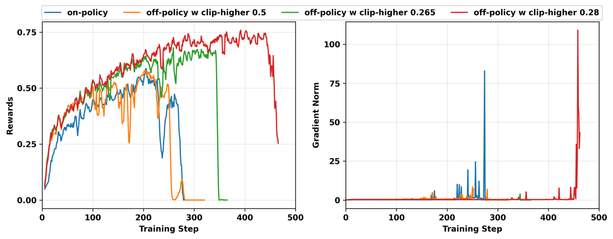
***Figure 1****. Rewards (****Left ****) and gradient norms (****Right ****) from our four failed GRPO TIR experiments on Qwen3-14B-Base. All experiments sample **`1024`** trajectories (**`64`** prompts × **`16`** responses) at each training step and use a learning rate of **`1e-6`**. The **`ppo_mini_batch_size`** is set to **`1024`** and **`256`** for on-policy and off-policy experiments, respectively.*

<!-- block:291211a5-58b7-800e-b8b9-e7fec9a257a1 type:callout depth:1 -->


<!-- block:292211a5-58b7-80cb-b26d-f4398b15bb05 type:text depth:2 -->
**Latest Update**

<!-- block:2bf211a5-58b7-80c8-a86a-d06945718bbc type:text depth:2 -->
**[*****Dec 2*****] **[#DeepSeek-V3.2](https://arxiv.org/abs/2512.02556) (https://arxiv.org/abs/2512.02556) adopts our **geometric** **sequence masking** to deal with **training-inference mismatch and general off-policy training instability**!

<!-- block:2c3211a5-58b7-80da-a760-f6cdaa0f0c16 type:text depth:2 -->
**[Dec 1]** Our work is discussed in [[Stabilizing Reinforcement Learning with LLMs: Formulation and Practices](https://arxiv.org/abs/2512.01374)] from **Qwen team**.

<!-- block:2a4211a5-58b7-80dd-85eb-facea672bd7c type:text depth:2 -->
**[Nov 12] **Rollout Correction for General Off-Policy Problems was merged into VeRL: [[Usage Documents](https://verl.readthedocs.io/en/latest/algo/rollout_corr.html)][[More Details](https://verl.readthedocs.io/en/latest/algo/rollout_corr_math.html)] ([Yingru Li](http://richardli.xyz))

<!-- block:2c1211a5-58b7-8048-9a1c-f48f0552fe53 type:text depth:2 -->
**[Nov 10] **Very excited to see that our work was discussed in a** **[vLLM blog](https://blog.vllm.ai/2025/11/10/bitwise-consistent-train-inference.html), where they implemented the “Bitwise Consistent On-Policy Reinforcement Learning”.

<!-- block:29d211a5-58b7-80a4-80bf-f01d038e7f08 type:text depth:2 -->
**[Oct 31] **VeRL fully async module has integrated our work in [[PR](https://github.com/volcengine/verl/pull/3955)].

<!-- block:29d211a5-58b7-8085-9333-d4ea9b6bca4f type:text depth:2 -->
**[Oct 20] **Slime has integrated our work in [[PR](https://github.com/THUDM/slime/pull/429)]. (SGLang RL: [Chenyang Zhao](https://github.com/zhaochenyang20), [Jiajun Li](https://www.linkedin.com/in/jiajun-li-guapisolo/))

<!-- block:2c1211a5-58b7-807d-98df-e396b392553d type:text depth:2 -->
**[Oct 16] **Very excited to see that our work is **cited by ****[SWE-grep](https://cognition.ai/blog/swe-grep#motivation)**** at Cognition****,** which also uses sequence-level **masked** importance sampling (MIS) to address the training-inference mismatch.

<!-- block:291211a5-58b7-80f1-9c73-f71a294cfc7d type:text depth:2 -->
**[Oct 15] **A Megatron training crash issue was resolved via the geometric-level masking.

<!-- block:291211a5-58b7-808d-870f-fcff431f4357 type:external_object_instance depth:2 -->

https://github.com/volcengine/verl/issues/3597

<!-- block:29d211a5-58b7-8053-bb32-c3122176e17b type:text depth:2 -->
**[Oct 13] **VeRL has integrated our work in [[VeRL 0.6.0](https://github.com/volcengine/verl/releases/tag/v0.6.0)][[PR](https://github.com/volcengine/verl/pull/3694)], including the newly introduced ***sequence*** ***masking/rejection with geometric mean of importance weight (Geo-MIS/Geo-RS)***. ([Yingru Li](http://richardli.xyz))

<!-- block:271211a5-58b7-80f7-8789-fd2833260f55 type:callout depth:1 -->


<!-- block:271211a5-58b7-808c-8d7b-caebe4c40799 type:header depth:2 -->
## **TL;DR:**

<!-- block:277211a5-58b7-80a6-8d32-e5e211878239 type:text depth:2 -->
The relentless push for faster inference has created a dangerous "training-inference mismatch" that can silently kill reinforcement learning with LLMs. Our investigation reveals a vicious cycle that is particularly acute in modern reasoning and agentic RL:

<!-- block:277211a5-58b7-804e-a899-cfa16040f0c7 type:bulleted_list depth:2 -->
  - **OOD Contexts Drive Low-Probability Sampling:** Agentic workflows expose models to external inputs and dynamic environments, forcing frequent generation of **low-probability tokens** that are essential for novel reasoning, tool calls, and adaptive responses. ‣ 

<!-- block:277211a5-58b7-80d9-ad38-ccdc1dfe9f5a type:bulleted_list depth:2 -->
  - **Low-Probability Tokens Amplify Training Collapse:** These tokens become the weakest link—the training-inference mismatch is most severe for them, causing catastrophically large gradients that lead to silent degradation and sudden training failure. ‣    

<!-- block:277211a5-58b7-807d-900e-f24aa1b5c3f7 type:bulleted_list depth:2 -->
  - **Hardware Variability Complicates the Problem:** Different GPU architectures exacerbate the mismatch unpredictably, meaning the same agentic training setup can succeed on one machine and catastrophically fail on another. ‣ 

<!-- block:277211a5-58b7-8012-83a7-dd70b7fc9829 type:bulleted_list depth:2 -->
  - **Sequence-Level Correction is the Principled Solution:** **Sequence-level Correction** emerges as the theoretically grounded fix. It corrects the biased gradients by accounting for the full state trajectory, restoring training stability **across different hardware and complex tasks.** ‣ 

<!-- block:2bd211a5-58b7-8033-a485-d9407b771feb type:callout depth:1 -->


<!-- block:2bd211a5-58b7-80b4-974c-c6987ef77b41 type:header depth:2 -->
## **Deeper Analysis:**

<!-- block:2bd211a5-58b7-808e-a28e-e287fc3822af type:text depth:2 -->
For a rigorous theoretical breakdown of this problem, we've published a 3-part blog series to give more insights: 

<!-- block:2c4211a5-58b7-802b-808c-f610d4db1d04 type:bulleted_list depth:2 -->
  - **[[Part 1: Why Off-Policy Breaks RL — An SGA Analysis Framework]](https://richardli.xyz/rl-collapse-1)** **Known (TRPO theory):** The surrogate objective $L_\mu(\pi)$ is a first-order Taylor approximation of RL objective $J(\pi)$; the TRPO lower bound $J(\pi) \ge L_\mu(\pi) - C \cdot T^2 \cdot D_{TV}^{\max}$ shows the approximation error grows with $T^2$, requiring the trust region to shrink as $\delta \propto 1/T^2$. **Our insight:** Token-level IS (PPO/GRPO) computes $\nabla L_\mu$, not $\nabla J$—it corrects the token distribution but not the state distribution mismatch ($d_\mu \ne d_\pi$), resulting in $O(T^2 D_{TV}^{\max})$ bias. **We formalize two failure modes via the SGA Lemma**: **Bias** (measured by $D_{TV}$) and **Variance** (measured by $\chi^2$-divergence)—these metrics are not interchangeable.

<!-- block:2c4211a5-58b7-8030-bd63-d60722697c06 type:bulleted_list depth:2 -->
  - **[[Part 2: Applying the SGA Framework — Token v.s. Sequence-level Correction]](https://richardli.xyz/rl-collapse-2)** **Our analysis:** Token-level IS (PPO/GRPO) has $O(T^2 D_{TV}^{\max})$ bias from the surrogate's first-order approximation error; Sequence-level IS is unbiased but has exponential variance $O((1+\bar{\chi}^2_{\max})^T)$. **Our solution:** Seq-TIS achieves controllable bias-variance trade-off via clipping $\rho(y) \to \min(\rho(y), C)$. **Key conclusion:** This bias is a sequence-level problem requiring sequence-level solutions **when non-negligible**.

<!-- block:2c4211a5-58b7-8082-8edd-c06110f99479 type:bulleted_list depth:2 -->
  - **[[Part 3: Trust Region Optimization via Sequence Masking]](https://richardli.xyz/rl-collapse-3)** **Known (TRPO theory):** Trust region constraints ensure the surrogate remains a valid approximation. **Our solutions:** (1) **Seq-MIS** enforces a Hard Trust Region via rejection $\mathbb{I}(\rho \le C) \cdot \rho \cdot f$, excluding OOD samples entirely. (2) **Geo-RS** uses the geometric mean $\rho_{\text{geo}}=\rho^{1/T}$ to achieve a **length-invariant Per-Token Trust Region**—a practical implementation of TRPO's hard trust region for LLMs that avoids systematic rejection of long sequences.

<!-- block:2b8211a5-58b7-80c9-80fe-cd864e334308 type:transclusion_container depth:1 -->


<!-- block:271211a5-58b7-8057-a4a9-fe5550d04cb1 type:header depth:2 -->
## Citation

<!-- block:271211a5-58b7-80c0-bdba-f8043a361bcc type:code depth:2 -->
```JavaScript
@online{liu-li-2025-rl-collapse,
  title = {When Speed Kills Stability: Demystifying {RL} Collapse from the Training-Inference Mismatch},
  author = {Liu, Jiacai and Li, Yingru and Fu, Yuqian and Wang, Jiawei and Liu, Qian and Jiang, Zhuo},
  year = {2025},
  month = sep,
  url = {https://richardli.xyz/rl-collapse}
}
```

<!-- block:271211a5-58b7-804d-b209-d12262749c7e type:header depth:1 -->
## **1. The Mystery of the Sudden Collapse**

<!-- block:277211a5-58b7-8038-b454-fcd3581d713a type:text depth:1 -->
In the rapidly advancing field of reinforcement learning for large language models (LLM-RL), a frustrating pattern of sudden training collapse is emerging. Whether in complex **reasoning RL** or multi-turn **agentic RL**, many have observed training runs that, after a period of stable learning, catastrophically fail.

<!-- block:277211a5-58b7-802c-90e3-f0072fb4f4f6 type:text depth:1 -->
We recently encountered this firsthand while conducting agentic RL experiments for multi-turn tool-integrated-reasoning (TIR) on Qwen3 models. This occurred across both on-policy and off-policy variants of the GRPO algorithm on our L20 GPU cluster. Figure 1 shows the reward and gradient norm dynamics of our four crashed experiments on Qwen3-14B-Base. As training progresses, the gradient norms suddenly explode, leading to model collapse. Our initial investigation focused on common culprits:

<!-- block:277211a5-58b7-8046-a918-f05a425996a9 type:bulleted_list depth:1 -->
- We examined the code and confirmed that our agent loop follows a token-in-token-out process.

<!-- block:277211a5-58b7-8058-b17d-ffc5b440e8cb type:bulleted_list depth:1 -->
- We tuned the hyperparameters `beta1` and `beta2` in the Adam optimizer.

<!-- block:277211a5-58b7-8002-b0e4-cb7b0d947723 type:bulleted_list depth:1 -->
- We also applied batch normalization to the advantages to balance the updates.

<!-- block:277211a5-58b7-8066-a42e-ebf293d000c7 type:text depth:2 -->
...

<!-- block:277211a5-58b7-8093-83f9-e7226af53cb1 type:text depth:1 -->
However, none of these standard fixes worked. Since even the simpler on-policy experiments failed, we suspected the issue was not with the RL algorithm but with a more fundamental part of the training stack. This led us to investigate a critical and increasingly prevalent challenge in modern LLM-RL: the unavoidable gap between highly-optimized inference engines and faithful training frameworks.

<!-- block:277211a5-58b7-806b-ad86-d2218563a53a type:divider depth:1 -->
---

<!-- block:271211a5-58b7-8068-bb2e-fda81fd79c4b type:header depth:1 -->
## **2. A Fundamental Conflict: The Growing Gap Between Inference and Training**

<!-- block:271211a5-58b7-8075-ad1d-e1c28508a69d type:text depth:1 -->
Rollout speed is a core bottleneck in LLM-RL. To achieve the massive throughput required, modern inference engines (e.g., vLLM, SGLang, TensorRT-LLM) employ aggressive optimization strategies like speculative decoding, low-precision computation (INT8/FP8), and specialized, batch-variant CUDA kernels. While maintaining sampling fidelity,** the primary objective of modern inference engines is to maximize throughput**,** **often measured in tokens per second. **Conversely, training frameworks (e.g., FSDP, DeepSpeed, Megatron-LM)** **must strike a different balance, prioritizing numerical stability and precision for gradient computation, **often using higher-precision formats like FP32 for master weights and optimizer states. **This divergence in optimization priorities and constraints creates an inevitable training-inference mismatch.** The relentless push for faster rollouts is making this gap wider, not smaller. While one might propose enforcing identical calculations (e.g., using ["batch invariant kernels"](https://thinkingmachines.ai/blog/defeating-nondeterminism-in-llm-inference/)), these solutions come with a severe performance penalty, defeating the purpose of using a high-speed inference engine in the first place. **This speed-vs-consistency trade-off is at the heart of the problem, making it a persistent challenge rather than a simple engineering fix.**

<!-- block:271211a5-58b7-80ca-a1d1-d18bc503801a type:text depth:1 -->
In our stack, this mismatch manifested between our vLLM inference sampler and our FSDP trainer. The actual parameter update was:

<!-- block:271211a5-58b7-805a-8edc-d856427744e3 type:equation depth:1 -->
$$
\mathbb{E} _{x\sim \mathcal{D}}\mathbb{E} _{y\sim \textcolor{red}{\pi _{\theta}^{\mathrm{vllm}}}\left( \cdot |x \right)}\left[ R\left( x,y \right) \nabla _{\theta}\log \textcolor{blue}{\pi _{\theta}^{\mathrm{fsdp}}}\left( y|x \right) \right],
$$

<!-- block:271211a5-58b7-8075-8d39-edad869719ad type:text depth:1 -->
whereas the theoretical parameter update should be

<!-- block:271211a5-58b7-8096-bc46-dbecb4d4e6e5 type:equation depth:1 -->
$$
\mathbb{E} _{x\sim \mathcal{D}}\mathbb{E} _{y\sim \textcolor{blue}{\pi _{\theta}^{\mathrm{fsdp}}}\left( \cdot |x \right)}\left[ R\left( x,y \right) \nabla _{\theta}\log \textcolor{blue}{\pi _{\theta}^{\mathrm{fsdp}}}\left( y|x \right) \right].
$$

<!-- block:271211a5-58b7-8022-ab19-dc1c49af2929 type:text depth:1 -->
Here $x$ is the prompt sampled from the distribution $\mathcal{D}$, $y$ is the response, $R$ is the reward function, $\theta$ is the parameter of LLM,  $\textcolor{red}{\pi^\text{vllm}_\theta}$ and $\textcolor{blue}{\pi^\text{fsdp}_\theta}$ are the policy implemented in vLLM engine and FSDP engine respectively. To investigate this, we first needed a way to measure it.

<!-- block:277211a5-58b7-80bb-8063-e98e153b97c9 type:divider depth:1 -->
---

<!-- block:271211a5-58b7-8046-af48-c3129693f3f1 type:header depth:1 -->
## **3. Anatomy of the Training Collapse**

<!-- block:271211a5-58b7-80f8-b824-f71b5fe11763 type:sub_header depth:1 -->
### **3.0 **Experiments Setup

<!-- block:271211a5-58b7-8011-872c-ff8c4e24455f type:text depth:1 -->
Unless otherwise specified, the experiments presented in **Section 3** and **Section 4** are conducted on the **[VeRL](https://github.com/search?q=verl&type=repositories)**** **framework under the TIR setting, using the vLLM v1 sampler (AsyncvLLMServer), the Qwen3-14B-Base model, and the GRPO algorithm, all running on an L20 GPU cluster.

<!-- block:277211a5-58b7-80de-809d-ed58cc96a034 type:divider depth:1 -->
---

<!-- block:271211a5-58b7-8057-8bd8-da62a18d6e3a type:sub_header depth:1 -->
### **3.1 Measuring the Mismatch: The **`**vllm-kl**`** Metric**

<!-- block:271211a5-58b7-80be-bf0e-d70767335f76 type:text depth:1 -->
A very straightforward metric for measuring the training-inference mismatch is **vllm-kl**:

<!-- block:271211a5-58b7-80f6-9ba6-e24d819d0485 type:equation depth:1 -->
$$
\small{\mathbb{E}_{s\sim d_{\textcolor{red}{\pi^\text{vllm}_\theta}}}\left[\text{KL}\left(\textcolor{red}{\pi^\text{vllm}_\theta}\left(\cdot|s\right),\textcolor{blue}{\pi^\text{fsdp}_\theta}\left(\cdot|s\right)\right)\right] = \mathbb{E}_{s\sim d_{\textcolor{red}{\pi^\text{vllm}_\theta}},a\sim {\textcolor{red}{\pi^\text{vllm}_\theta}\left(\cdot|s\right)}} \left[\log\left(\frac{\textcolor{red}{\pi^\text{vllm}_\theta}(a|s)}{\textcolor{blue}{\pi^\text{fsdp}_\theta}(a|s)}\right)\right],}
$$

<!-- block:271211a5-58b7-80c4-a955-ea90e314216d type:text depth:1 -->
where $d_\pi$ is the state-occupancy of a policy $\pi$, $s$ is the context prefix (state) and $a$ is the token (action).  Note that our experiments involve tool calls, meaning the response  $y$ may include tool responses. Therefore, our  `vllm-kl` metric only considers tokens generated by the model itself. The following code provides an implementation in **[VeRL ](https://github.com/search?q=verl&type=repositories)**for calculating the vllm-kl metric using the [K3 estimator](http://joschu.net/blog/kl-approx.html), assuming that the token probabilities of inference engine are already accessible:

<!-- block:271211a5-58b7-804d-a515-cf72e195691b type:toggle depth:1 -->
codeblock of K3 estimator for `vllm-kl`

<!-- block:271211a5-58b7-8012-a9f1-e15e76434fd9 type:code depth:2 -->
```Python
rollout_log_probs = batch.batch["rollout_log_probs"] # pi_vllm
actor_old_log_probs = batch.batch["old_log_probs"] # pi_fsdp
response_mask = batch.batch["response_mask"]
log_ratio = actor_old_log_probs - rollout_log_probs 
vllm_k3_kl_matrix = torch.exp(log_ratio) - log_ratio - 1
vllm_k3_kl = masked_mean(vllm_k3_kl_matrix,response_mask)
```

<!-- block:277211a5-58b7-80e1-92cf-f20011be2769 type:divider depth:1 -->
---

<!-- block:271211a5-58b7-806f-a251-c6e6bcade90c type:sub_header depth:1 -->
### 3.2 **The Warning Signs: Correlated Instability**

<!-- block:271211a5-58b7-8043-b721-efdbf1c851cb type:text depth:1 -->
Our first clue was that high `vllm-kl` values were not isolated events. They correlated strongly with other signs of instability. 

<!-- block:271211a5-58b7-80e6-a27d-df95d40e31e0 type:sub_sub_header depth:1 -->
#### 3.2.1 Fluctuations **in FSDP Entropy and Rewards**

<!-- block:271211a5-58b7-808f-a90f-df4730390799 type:text depth:1 -->
In many of our experiments, we have observed that abnormal spikes in `vllm-kl` typically trigger simultaneous anomalous fluctuations in the entropy of FSDP policy $\textcolor{blue}{\pi^\text{fsdp}_\theta}$ and rewards. The experimental results presented in Figure 2 serve as an intuitive example.  As it can be seen in the figure, **the locations where entropy spikes occur almost perfectly correspond with the locations of **`**vllm-kl**`** spikes**. While no equally pronounced correlation is observed in the rewards, a massive `vllm-kl` spike around step 250 can be seen, which triggered the generation of a low-quality batch and resulted in a noticeable dip there as well.  **This means that when the mismatch is large, both the vLLM policy **$\textcolor{red}{\pi^\text{vllm}_\theta}$ **and the FSDP policy **$\textcolor{blue}{\pi^\text{fsdp}_\theta}$ ** enter an unstable region.**

<!-- block:271211a5-58b7-8055-8f35-c4a618ee5fed type:image depth:1 -->
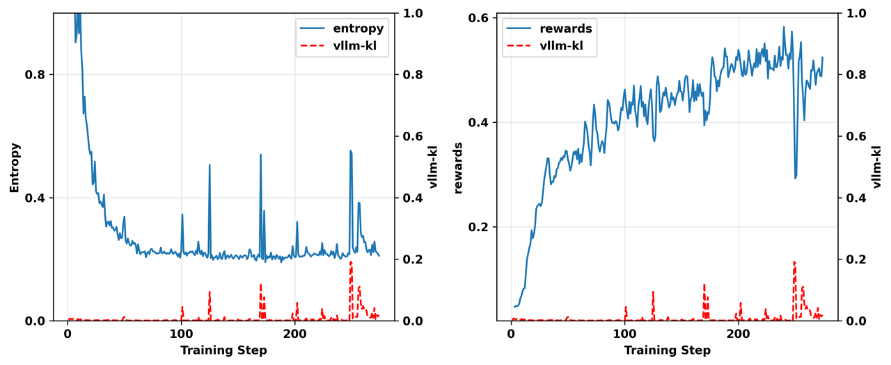
***Figure 2****. Comparative presentation of an on-policy experiment result showing ****entropy ****(****Left****) and ****rewards ****(****Right****) alongside **`**vllm-kl**`** values, illustrating their correlation during the training phase. *

<!-- block:277211a5-58b7-805f-b028-ed2aaa0553fc type:divider depth:1 -->
---

<!-- block:271211a5-58b7-80b3-b8f8-eb93ea995636 type:sub_sub_header depth:1 -->
#### **3.2.2 Rising FSDP PPL and Gradient Norm Leading to Policy Collapse**

<!-- block:271211a5-58b7-8048-9746-ef5351a74003 type:text depth:1 -->
More critically, we observed a spike in `vllm-kl` simultaneously triggering an explosion in both the fsdp-[ppl](https://www.wikiwand.com/en/articles/Perplexity) metric and the gradient norm. In our experiments, the fsdp-ppl metric of a response $y$ is calculated as follows: 

<!-- block:271211a5-58b7-8054-8737-dd5a1b74c83c type:equation depth:1 -->
$$
\text{fsdp-ppl}:  \exp\left(\frac{-1}{\left| \mathcal{T} _{\mathcal{M}}\left( y \right) \right|}\sum_{t\in \mathcal{T} _{\mathcal{M}}\left( y \right)}{\log \textcolor{blue}{\pi _{\theta}^{\text{fsdp}}}\left( y_t|y_{<t} \right)}\right)
$$

<!-- block:271211a5-58b7-80a7-bc39-d63c27611086 type:text depth:1 -->
where $\mathcal{T} _{\mathcal{M}}\left( y \right)$ is the index set of the tokens generated by the model itself in the response $y$.  The final fsdp-ppl metric is the average of the fsdp-ppl metrics for all responses in the batch. Figure 3  present the experimental results for an on-policy version and an off-policy version of GRPO. In both experiments, the spikes in `vllm-kl` almost precisely triggered corresponding explosions in the fsdp-ppl and gradient norm. Moreover, it can be observed that before the training reward collapses, there is a significant  rising in the `vllm-kl` metric.

<!-- block:271211a5-58b7-8012-87d3-ce3f15ed3061 type:image depth:1 -->
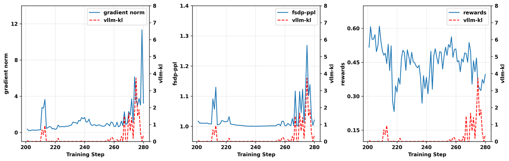


<!-- block:271211a5-58b7-8046-aba6-f54c74a49cf2 type:image depth:1 -->
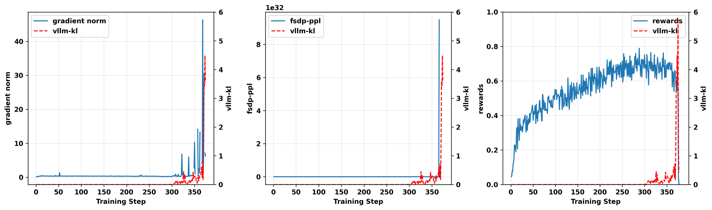
***Figure 3****.  Results of  an on-policy experiment from step 200 - 280 (****Top****) and an off-policy experiment with clip-higher 0.28 (****Bottom****), showing ****gradient norm**** (****Left****), ****fsdp-ppl**** (****Middle ****) and ****rewards ****(****Right****)  alongside **`**vllm-kl**`** values, illustrating their correlation during the training.*

<!-- block:271211a5-58b7-80f1-b8fd-fd93435d5365 type:text depth:1 -->
In our experiments, the sequences generated by the model itself consist of at least several hundred tokens. Therefore, in the later stages of training, it is more reasonable for the ppl metric to remain around 1. However, in batches with significant training-inference mismatch—that is, where `vllm-kl` is significant high—an explosion in the fsdp-ppl metric was observed**. ****This indicates that the FSDP engine assigning catastrophically low probabilities to tokens that the inference policy sampled, leading to gradient explosion. **This observation helped us further pinpoint where mismatches are more likely to occur. In fact, as we will see later, when these extremely low-fsdp-probability tokens were sampled, their probabilities in vLLM engine were not nearly as low.

<!-- block:277211a5-58b7-8053-933b-eb574993d0ce type:divider depth:1 -->
---

<!-- block:271211a5-58b7-8043-9a6b-f4222291f060 type:sub_header depth:1 -->
### **3.3 The Smoking Gun: The Low-Probability Token Pitfall**

<!-- block:277211a5-58b7-8056-afbf-fa0d227e8459 type:text depth:1 -->
**The mismatch was not uniform. **

<!-- block:277211a5-58b7-804c-b071-d15a4d40365e type:text depth:1 -->
By analyzing batches with varying levels of `vllm-kl`, we found a stark pattern: **the divergence is most severe for tokens that have a low probability according to the vLLM inference engine.** As a token's inference probability approaches zero, the training probability can become orders of magnitude smaller, leading to an infinite PPL and gradient. To ensure the conclusions are as generalizable as possible, we selected batches sampled from various experiments prior to training collapse, taken at different training steps. All of these batches exhibit relatively high `vllm-kl` values, enabling us to study mismatch patterns under pronounced conditions. Rollout batches were collected within the following three `vllm-kl` ranges, with five batches (around 5M tokens) in each group:

<!-- block:271211a5-58b7-8010-8a35-e7633703fd9b type:bulleted_list depth:1 -->
- **Group 1 (low): ** Each rollout batch has a `vllm-kl` no greater than 1e-3, and the batches are sampled using H20 GPUs.

<!-- block:271211a5-58b7-8015-93c9-e4e2ef8301f1 type:bulleted_list depth:1 -->
- **Group 2 (medium):  **Each rollout  batch has a `vllm-kl` belongs to [1e-3, 2e-2], and the batches are sampled using L20 GPUs.

<!-- block:271211a5-58b7-800a-88cd-e2fe0fb1c394 type:bulleted_list depth:1 -->
- **Group 3 (high):  **Each rollout  batch has a `vllm-kl` belongs to [2e-2, 1e-1], and the batches are sampled using L20 GPUs.

<!-- block:271211a5-58b7-80dd-83a4-c319ae9b7b6d type:text depth:1 -->
Figure 4 (a)(b)(c) below shows the relationship between the output probabilities of the vLLM engine, i.e. $\textcolor{red}{\pi^\text{vllm}_\theta}(a|s)$ and the mismatch—measured by $\log\left(\textcolor{blue}{\pi^\text{fsdp}_\theta}(a|s)\right)-\log\left(\textcolor{red}{\pi^\text{vllm}_\theta}(a|s)\right)$ —under different magnitudes of `vllm-kl`:

<!-- block:271211a5-58b7-8025-976d-c69c3de0ef2d type:image depth:1 -->
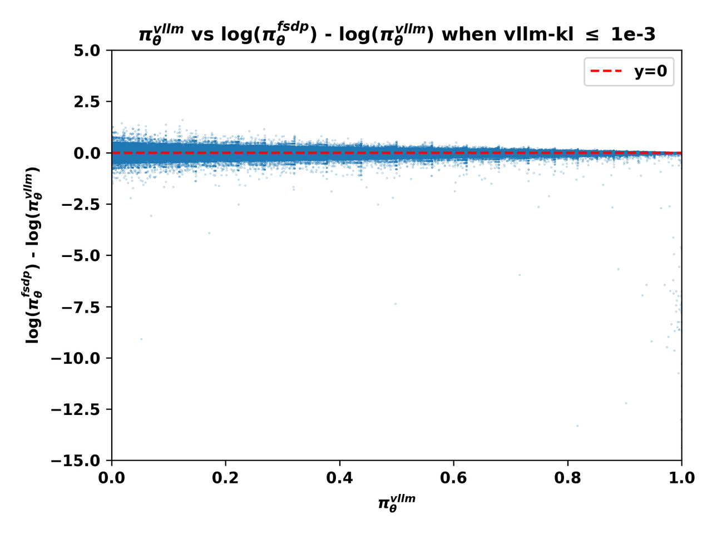
***Figure 4 (a)****.**** ****$\textcolor{red}{\pi^\text{vllm}_\theta}$**  vs **$\log\left(\textcolor{blue}{\pi^\text{fsdp}_\theta}\right)-\log\left(\textcolor{red}{\pi^\text{vllm}_\theta}\right)$** for tokens in the batches of group 1.*

<!-- block:271211a5-58b7-8084-87e0-d30121785272 type:image depth:1 -->
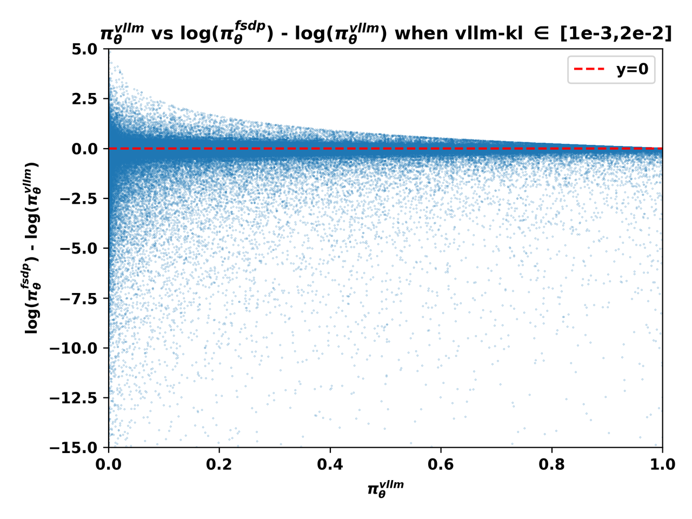
***Figure 4 (b)****.**** ****$\textcolor{red}{\pi^\text{vllm}_\theta}$**  vs **$\log\left(\textcolor{blue}{\pi^\text{fsdp}_\theta}\right)-\log\left(\textcolor{red}{\pi^\text{vllm}_\theta}\right)$** for tokens in the batches of group 2.*

<!-- block:271211a5-58b7-8092-a67e-f3089c4cf067 type:image depth:1 -->
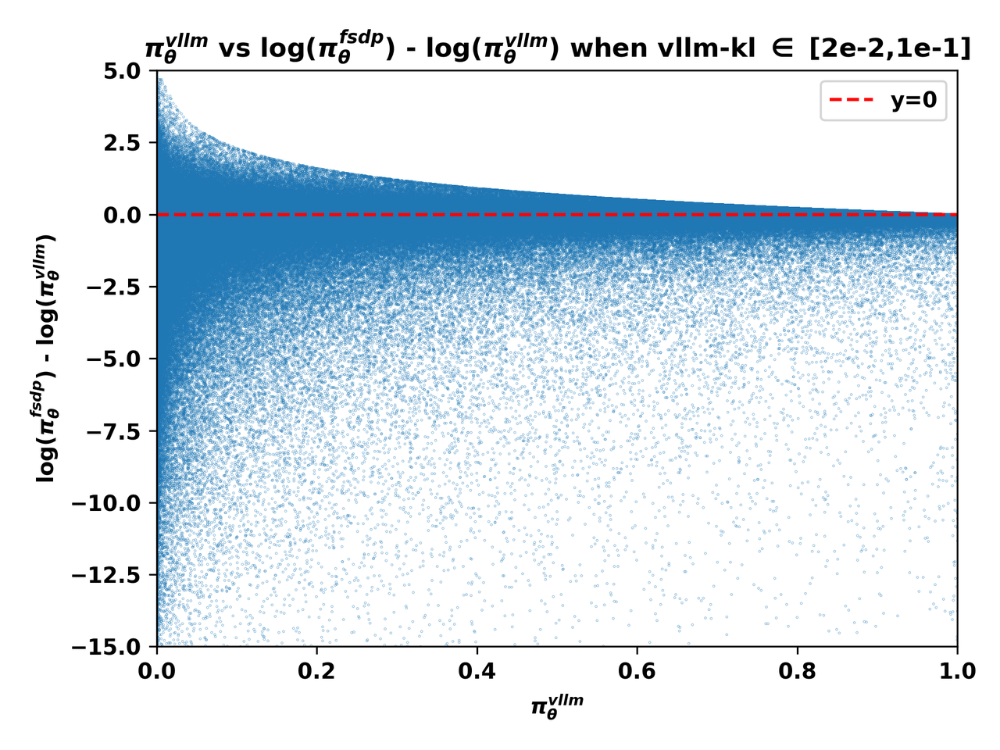
***Figure 4 (c).**** **$\textcolor{red}{\pi^\text{vllm}_\theta}$**  vs **$\log\left(\textcolor{blue}{\pi^\text{fsdp}_\theta}\right)-\log\left(\textcolor{red}{\pi^\text{vllm}_\theta}\right)$** for tokens in the batches of group 3.*

<!-- block:271211a5-58b7-805f-bcbf-d246ba54362d type:text depth:1 -->
From the three figures above, we can clearly observe that:

<!-- block:271211a5-58b7-800a-88b0-cb2ff65c7b6d type:numbered_list depth:1 -->
1. The degree of mismatch tends to be more pronounced when the vLLM probability $\textcolor{red}{\pi^\text{vllm}_\theta}$ approaches zero, and the extreme values of $\log\left(\textcolor{blue}{\pi^\text{fsdp}_\theta}\right)-\log\left(\textcolor{red}{\pi^\text{vllm}_\theta}\right)$ are more likely to occur under these conditions.

<!-- block:271211a5-58b7-80a8-8b79-d87b04cf6f3c type:numbered_list depth:1 -->
1. The batches collected on L20 GPUs, namely those in groups 2 and 3, exhibit a training-inference mismatch that is primarily manifested as the FSDP probability $\textcolor{blue}{\pi^\text{fsdp}_\theta}$ being significantly smaller than the vLLM probability $\textcolor{red}{\pi^\text{vllm}_\theta}$.

<!-- block:277211a5-58b7-80bc-ae1a-df54182c0628 type:divider depth:1 -->
---

<!-- block:271211a5-58b7-8050-b3b1-dbbad2a1eb40 type:sub_header depth:1 -->
### 3.4 OOD Tool Responses Amplifies the Mismatch

<!-- block:277211a5-58b7-80d0-9d87-e202276dc7f9 type:sub_sub_header depth:1 -->
#### 3.4.1 The Mismatch Is More Severe in Non-First-Round Outputs

<!-- block:271211a5-58b7-8079-8ad0-d72e0e85ce0b type:text depth:1 -->
The finding in Section 3 explained why the problem was so acute in our multi-turn TIR experiments, **particularly in the non-first-round model outputs**. The process works as follows:

<!-- block:271211a5-58b7-809e-8568-f3c1bf646337 type:numbered_list depth:1 -->
1. The **agent** receives a tool response, which is often structured text (e.g., context enveloped by `<python_output>` and `</python_output>` tags) that is OOD compared to its pre-training and SFT data.

<!-- block:271211a5-58b7-80a2-82b3-da8b60bb1fdf type:numbered_list depth:1 -->
1. Faced with this unfamiliar OOD context, the **agent's policy** becomes more uncertain, making it more likely to sample low-probability tokens in its subsequent turns (which is also observed in **[SimpleTIR](https://github.com/ltzheng/SimpleTIR)**).

<!-- block:271211a5-58b7-80e1-905f-e8e323252c50 type:numbered_list depth:1 -->
1. As we just established, these low-probability tokens are the primary site where severe mismatch occurs, creating the conditions for a `fsdp-ppl` and gradient explosion.

<!-- block:271211a5-58b7-807f-8974-ccd834bcb702 type:text depth:1 -->
Next, we plot the mismatch in the batches of the three groups (around 5k trajectories per group), highlighting the differences between the first-round model outputs and non-first-round model outputs. We consider the following two methods to visualize the mismatch:

<!-- block:271211a5-58b7-8090-a724-cd2cf4996307 type:numbered_list depth:1 -->
1. **Log-ppl scatter plot**: The x-axis represents the logarithm of the ppl metric calculated by the vLLM policy $\textcolor{red}{\pi^\text{vllm}_\theta}$, denoted as `**vllm-log-ppl**`, and the y-axis represents the logarithm of the ppl  metric calculated by FSDP policy  $\textcolor{blue}{\pi^\text{fsdp}_\theta}$, denoted as `**fsdp-log-ppl**`.

<!-- block:271211a5-58b7-80f8-a083-d8dd1fc23b4c type:numbered_list depth:1 -->
1. **Probability scatter plot**: The x-axis represents the token probability of vLLM policy $\textcolor{red}{\pi^\text{vllm}_\theta}$ and the y-axis represents the token probability of FSDP policy  $\textcolor{blue}{\pi^\text{fsdp}_\theta}$.

<!-- block:271211a5-58b7-80da-a68a-cf9a7e67be87 type:text depth:1 -->
We present the visualization results of the mismatch for three groups below.

<!-- block:271211a5-58b7-802e-8f1c-fa8e9902f933 type:bulleted_list depth:1 -->
- **Group 1:  batches with **`**vllm-kl**`** ≤ 1e-3**

<!-- block:271211a5-58b7-805e-af00-de25affd1d4a type:image depth:1 -->
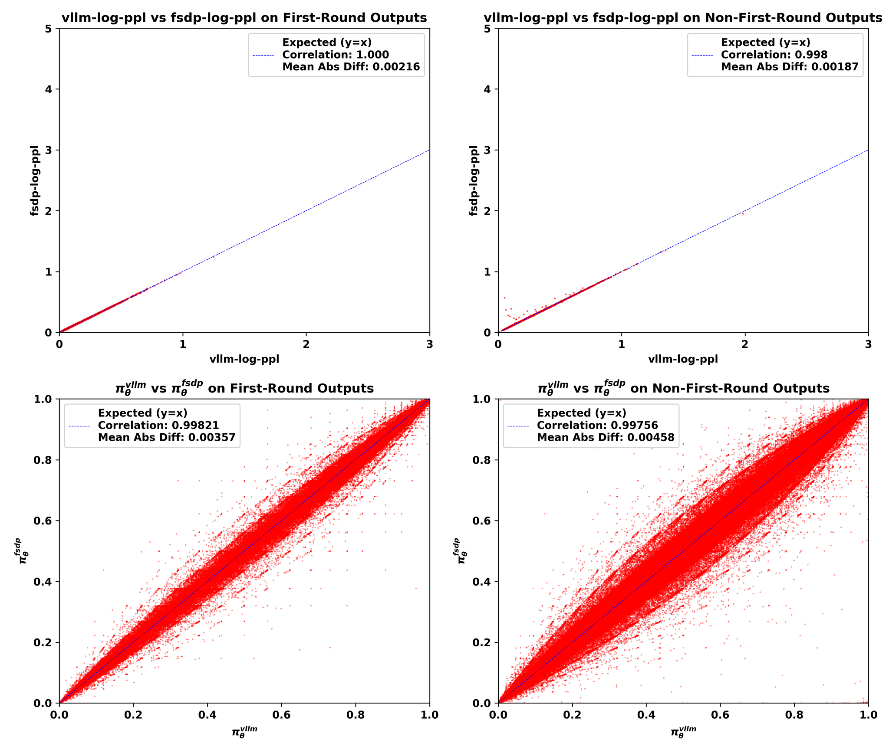


<!-- block:271211a5-58b7-804e-84f9-ca41fc298777 type:bulleted_list depth:1 -->
- **Group 2:  batches with **`**vllm-kl**`** ∈ [1e-3, 2e-2]**

<!-- block:271211a5-58b7-80cb-8597-da22a85d90da type:image depth:1 -->
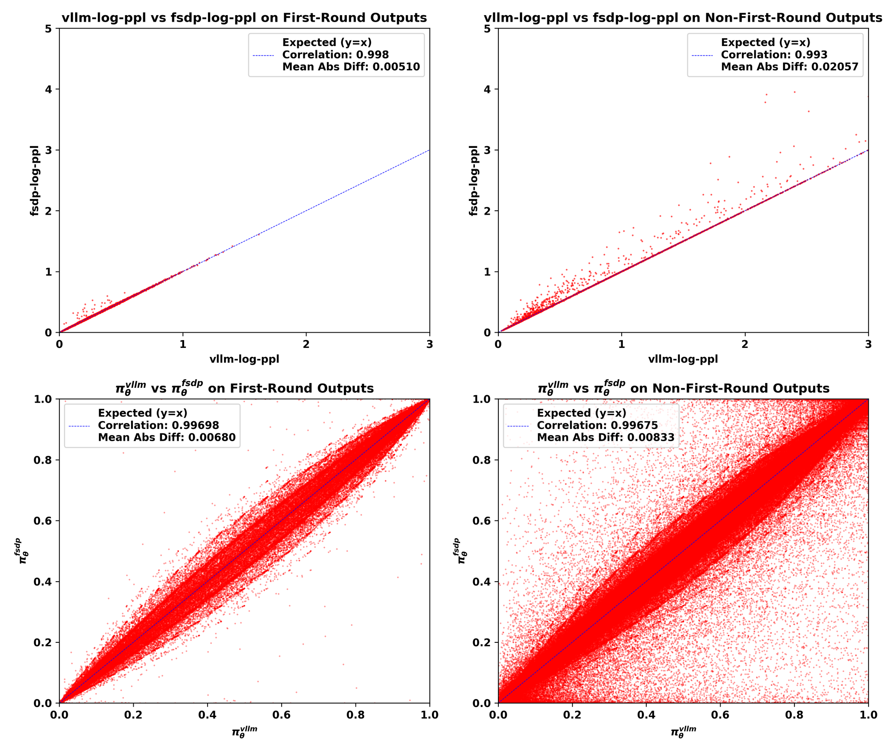


<!-- block:271211a5-58b7-807c-b2f5-db46f3b9cf4a type:bulleted_list depth:1 -->
- **Group 3:  batches with **`**vllm-kl**`** ∈ [2e-2, 1e-1]**

<!-- block:271211a5-58b7-8024-8265-c6f33580b3be type:image depth:1 -->
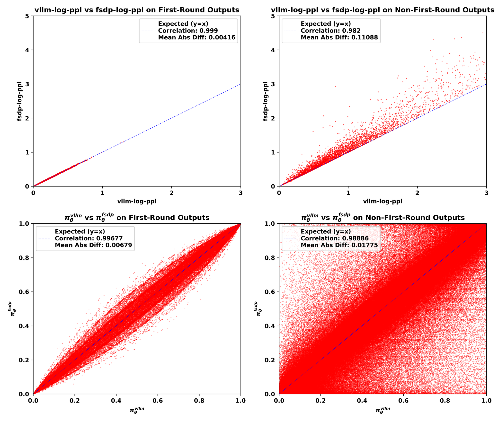


<!-- block:271211a5-58b7-80e8-bb59-d8c2c4839f75 type:text depth:1 -->
From the visualization results, we can observe that:

<!-- block:271211a5-58b7-80d4-bd8f-c072e9833bd0 type:numbered_list depth:1 -->
1. The `vllm-log-ppl` of non-first-round outputs is generally larger compared to the first-round outputs, which means more low-probability tokens are sampled when faced with unfamiliar OOD context. 

<!-- block:271211a5-58b7-80da-9a4f-f339c3272a45 type:numbered_list depth:1 -->
1. The mismatch primarily occurs in non-first-round model outputs, manifested by a larger mean absolute difference in both log-ppl and token probability between FSDP policy and vLLM policy compared to the first-round output, along with a lower Pearson correlation coefficient.

<!-- block:271211a5-58b7-80b7-9b90-e3adee7c73c7 type:numbered_list depth:1 -->
1. As the `vllm-kl` value increases, the training-inference mismatch primarily worsens in non-first-turn outputs.

<!-- block:271211a5-58b7-80ed-83ee-dd914cdf139e type:numbered_list depth:1 -->
1. The mismatch consistently show that the `fsdp-log-ppl` is greater than the `vllm-log-ppl` indicating that the FSDP engine produces more extreme low-probability tokens.

<!-- block:277211a5-58b7-80b6-9438-f97089a3b349 type:divider depth:1 -->
---

<!-- block:277211a5-58b7-805b-b021-d722c4d2eb3c type:sub_sub_header depth:1 -->
#### **3.4.2 More Tool Calls, More Training Instability**

<!-- block:277211a5-58b7-803e-a52c-f2b1fd47d9f1 type:text depth:1 -->
The following experiments also demonstrate that the OOD tool responses exacerbates the training-inference mismatch and training instability. We conducted off-policy GRPO experiments on H20 GPUs using Qwen3-14B-Base as the base model with clip higher=0.28 and 4 mini-batches. We set different maximum number of tool calls in a single trajectory (the hyperparameter `max_tool_turn`) at 20 and 100. The experimental results are shown in Figure 5 and 6. It can be observed that as the number of tool calls increases, the time to training collapse occurs earlier. Upon collapse, gradient explosion and an explosion in `vllm-kl` are observed in all cases.

<!-- block:277211a5-58b7-80fc-844d-edb200c466dc type:image depth:1 -->
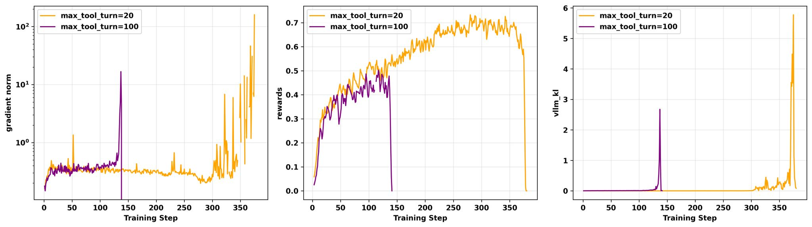
***Figure 5. ****Gradient norm (Left), rewards (Middle)  and **`Vllm-kl`** metric (Right) of the off-policy GRPO experiments with different value of the hyperparameter **`max_tool_turn`** .  All the experiments were conducted on H20 GPUs, using Qwen3-14B-Base as the base model with clip higher=0.28 and 4 mini-batches.*

<!-- block:277211a5-58b7-80ed-902c-f6a8bd68c885 type:image depth:1 -->
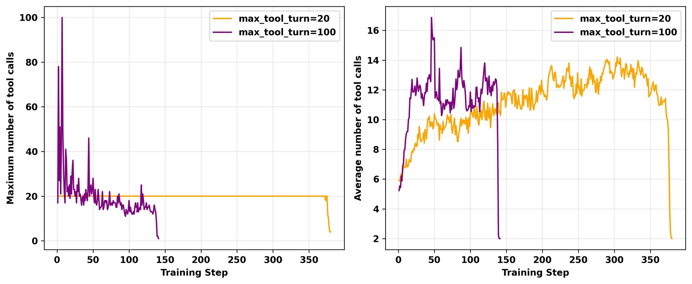
***Figure 6****. Maximum number of tool calls (Left) and average number of tool calls (Right)  of the off-policy GRPO experiments with different value of the hyperparameter **`max_tool_turn`**.  All the experiments were conducted on H20 GPUs, using Qwen3-14B-Base as the base model with clip higher=0.28 and 4 mini-batches.*

<!-- block:277211a5-58b7-8084-89d4-ea00c3bdbc3b type:divider depth:1 -->
---

<!-- block:271211a5-58b7-80c9-ad90-f8aa1353bfe1 type:sub_header depth:1 -->
### **3.5 The Environmental Factor: The Critical Role of Hardware**

<!-- block:271211a5-58b7-8008-a5ba-ec1353923d67 type:text depth:1 -->
Finally, we discovered that the physical hardware is a critical variable.** ****The exact same code and model produced drastically different levels of mismatch across different GPU hardware**. To evaluate the extent of mismatch across different hardware, we ran on-policy algorithms with identical code environments and hyperparameters, only switching between different GPUs for inference and training. Figure 7 illustrates the training dynamics on the L20, H20, and A100, respectively.

<!-- block:271211a5-58b7-807d-b017-dc3d1d908ff8 type:image depth:1 -->
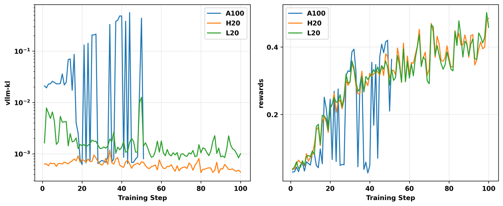
***Figure 7. ****`Vllm-kl`** metric (****Left****) and  rewards (****Right****) of the GRPO on-policy experiment across different GPUs.  All the experiments are conducted on the same code and environment.*

<!-- block:271211a5-58b7-8016-87f5-c640d0f8d5f0 type:text depth:1 -->
From the figure, it can be observed that in our experiments, the magnitude of the `vllm-kl` essentially follows: **H20 < L20 < A100**. Specifically, the `vllm-kl` for the H20 is generally on the order of 5e-4 to 1e-3, for the L20 it is around 1e-3 to 1e-2, and for the A100, it is predominantly between 1e-2 and 1. Due to the severe training-inference mismatch on the A100, normal training becomes unfeasible, resulting in highly unstable rewards curves.  

<!-- block:2a8211a5-58b7-8062-8a6a-ed98d6c13b5f type:text depth:1 -->
We found that disabling cascade attention in the vLLM engine was particularly helpful in reducing the mismatch in our experiments **run on** A100 GPUs. **We present these results** in Section ‣.

<!-- block:271211a5-58b7-8077-a02a-f7bad00d87a1 type:text depth:1 -->
The most compelling proof came when we took a failed L20 experiment and resumed it from a checkpoint on H20 GPUs (see Figure 8). The training immediately stabilized and recovered, proving the hardware's first-order impact on the problem.

<!-- block:271211a5-58b7-8039-b3b1-ddc62d10f463 type:image depth:1 -->
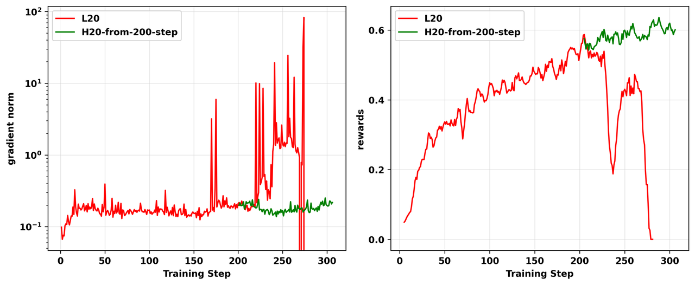
***Figure 8: ****Comparative results of the on-policy GRPO experiment between L20 and H20, showing the gradient norms (****Left)**** and rewards (****Right)****. We started the experiment on H20 GPUs (****green line****) from the checkpoint at the 200th training step of  the failed L20 experiment (****red line****)*

<!-- block:277211a5-58b7-8060-a17d-d48fb6c48d1e type:divider depth:1 -->
---

<!-- block:271211a5-58b7-8029-a918-f29c6ca7198d type:sub_header depth:1 -->
### **3.6 The Mismatch is Not Static: A Vicious Cycle Driven by Optimization**

<!-- block:271211a5-58b7-802e-a9bf-ea88ac4a7010 type:text depth:1 -->
One might assume the training-inference mismatch is a static property of the hardware and software stack. However, Our following "batch-filter" experiment proved that **the mismatch is coupled with the training dynamics and model’s state**.  

<!-- block:271211a5-58b7-8087-ab3d-c93b7634665c type:text depth:1 -->
We set up the following policy update strategy in our “**batch-filter”** experiment : for each training step, if the collected batch yields a `vllm-kl` metric greater than the threshold, we skip updating the model parameters on this batch, as such updates are prone to cause training collapse. Instead, we proceed directly to the next step, continuing data collection until a batch with a `vllm-kl` value below the threshold is obtained, at which point the model is updated. 

<!-- block:271211a5-58b7-80ff-9032-c093eab4840b type:text depth:1 -->
The logic behind this experiment is that if the degree of mismatch were entirely independent of the model's output distribution and the training dynamics, the magnitude of `vllm-kl` should exhibit the same distributions across different training steps. However, the experimental results presented in Figure 9 show that **once the model entered a certain state, it began consistently generating high-mismatch batches**, effectively halting training. This, along with the spiraling `vllm-kl` and `fsdp-ppl` seen in other runs (Figure 10), points to a dangerous feedback loop.

<!-- block:271211a5-58b7-80db-ad92-f9d2ded4a453 type:image depth:1 -->
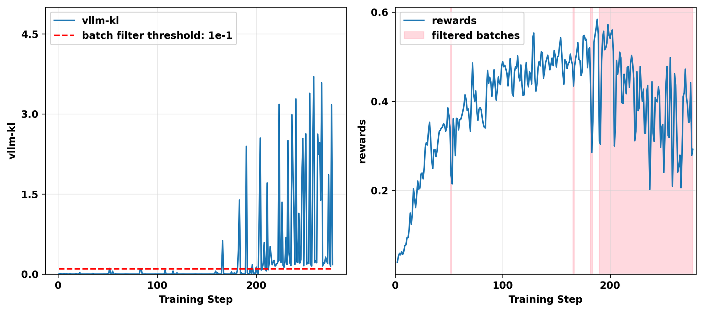
***Figure 9****.  The results of our on-policy “****batch-filter” ****experiment, showing **`**vllm-kl**`** (****Left****) and ****rewards ****(****Right****) with the training steps where batches are filtered out are highlighted in ****pink****. The filter threshold is set to 0.1.*

<!-- block:271211a5-58b7-80eb-8c3c-fc81889860ed type:image depth:1 -->
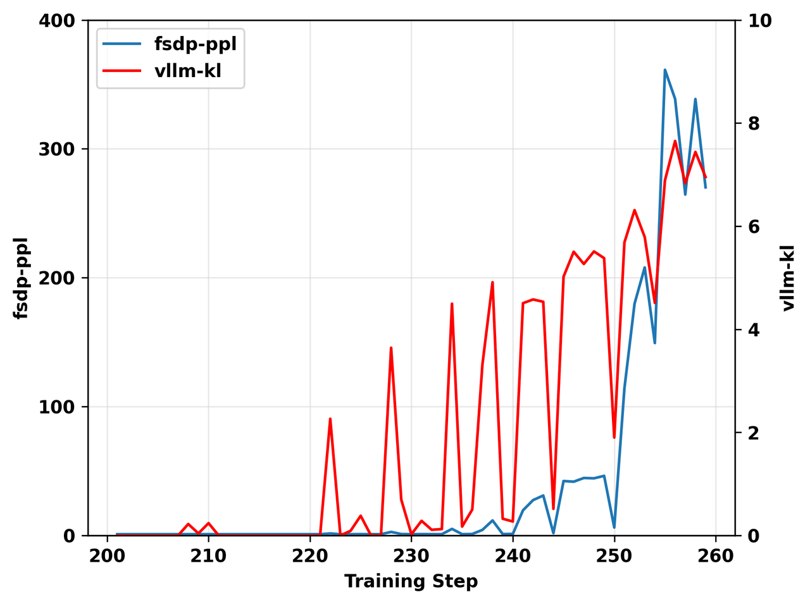
***Figure 10***.  The results of an on-policy experiment depict the `**vllm-kl**` and **fsdp-ppl** over training steps. The two lines exhibit a correlated, spiral-like upward pattern.

<!-- block:271211a5-58b7-8003-8533-ec98b0d66201 type:text depth:1 -->
**We hypothesize this is due to following two-stage failure cascade:**

<!-- block:271211a5-58b7-80ff-81ad-fa6e9105dbf4 type:numbered_list depth:1 -->
1. **Stage 1: Increased Numerical Sensitivity.** The RL optimizer pushes the model's weights into numerical ranges where the `bfloat16` data type has lower relative precision (e.g., very small or very large values).

<!-- block:271211a5-58b7-8080-8d52-fb6ef5e4adc4 type:numbered_list depth:1 -->
1. **Stage 2: Kernel-Driven Error Amplification.** These initial, tiny `bfloat16` quantization errors are then fed into the different kernel implementations of vLLM and FSDP. The differing calculation orders act as non-linear amplifiers, causing the small initial deviations to snowball into large differences in the final logits.

<!-- block:271211a5-58b7-80d5-a007-e96da4174eb1 type:text depth:1 -->
This creates a **vicious feedback loop**: mismatch leads to biased and noisy gradients, which might push the parameters further into a numerically sensitive region, which in turn worsens the mismatch for the next iteration, until the system collapses.

<!-- block:277211a5-58b7-80cc-bdf2-edc86beb5fbc type:divider depth:1 -->
---

<!-- block:271211a5-58b7-80b8-9a51-c4976dca1254 type:header depth:1 -->
## **4. Attempts to Alleviate Training-Inference Mismatch**

<!-- block:271211a5-58b7-8025-aee7-c19ceda8ac80 type:text depth:1 -->
Next, we will list the methods we have attempted to mitigate the training-inference mismatch. Some of these methods were helpful, while others were not.

<!-- block:271211a5-58b7-80f7-beba-e43453ed1380 type:sub_header depth:1 -->
### **4.1 Ineffective Attempts**

<!-- block:271211a5-58b7-80c3-96aa-ed277ca67b21 type:sub_sub_header depth:1 -->
#### 4.1.1 Use FP32 LM Head 

<!-- block:271211a5-58b7-802d-a418-e2b9da375651 type:text depth:1 -->
Inspired by the **[Minimax-M1 technical report](https://arxiv.org/abs/2506.13585)** and the blog post《**[Your Efficient RL Framework Secretly Brings You Off-Policy RL Training](https://fengyao.notion.site/off-policy-rl)**》, we patched vLLM to casting lm_head to fp32 precision. However, in our experiments, the mismatch problem still persisted after the patch and the model collapse was unavoidable. Figure 11 shows a failed on-policy experiment on the L20 GPU using a bf16 lm_head in the vLLM engine, and an experiment that started using an fp32 lm head on the vLLM engine after the 200th training step from the collapsed experiment. It can be observed that both experiments ultimately collapsed, and the experiment with the fp32 lm_head still exhibited a `vllm-kl` explosion.

<!-- block:271211a5-58b7-80d3-98ac-fe024795f621 type:image depth:1 -->
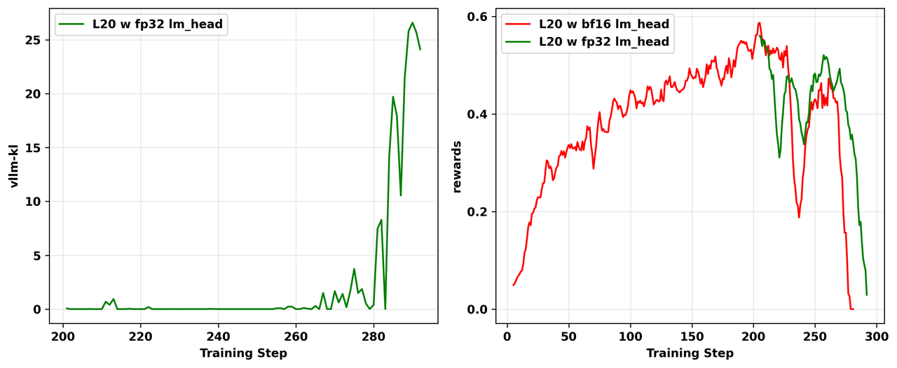
***Figure 11: ****Results of the ablation study on the precision of lm_head in ****vLLM ****engine.  ****Left****: The dynamics of **`vllm-kl`** metric. ****Right****: the dynamics of training rewards. We resume the RL training with ****fp32 lm_head **** from the 200th training step of  the failed experiment with ****bf16 lm_head***.

<!-- block:277211a5-58b7-8065-8a78-def969cdd1ca type:divider depth:1 -->
---

<!-- block:271211a5-58b7-80ee-960c-f43a87c9177a type:sub_sub_header depth:1 -->
#### **4.1.2 Disable Chunked Prefill**

<!-- block:271211a5-58b7-804e-b961-ec63fb9bf0a5 type:text depth:1 -->
We also attempted to resume the RL training from the 200th training step of the failed  experiment with bf16 lm_head  in Section 4.1.1 , disabling [chunked prefill](https://docs.vllm.ai/en/v0.4.2/models/performance.html) to see if it would resolve the crash. However, our experimental results (as shown in Figure 12) indicate that this approach did not resolve the crash issue.

<!-- block:271211a5-58b7-8054-8c5b-d9ce67ee4d3d type:image depth:1 -->
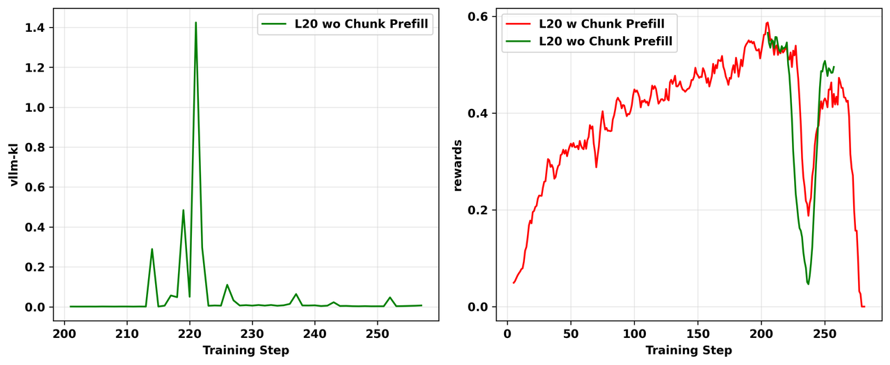
***Figure 12: ****Results of the ablation study on the using of chunked prefill.  We reran the RL training with **chunked prefill disabled**, starting from the 200th training step of the previously failed experiment conducted with **chunked prefill enabled**.* ***Left****: The dynamics of **`vllm-kl`** metric. ****Right****: the dynamics of training rewards.*

<!-- block:271211a5-58b7-8079-881a-cb3f4f1ef2c6 type:sub_sub_header depth:1 -->
#### 4.1.3 Enable `enforce_eager`  and `free_cache_engine` 

<!-- block:271211a5-58b7-80f3-a489-f51061ca6f89 type:text depth:1 -->
The [VeRL's official recipe of DAPO](https://verl.readthedocs.io/en/latest/algo/dapo.html) mentions that enabling CUDA graphs ( `enforce_eage=False`) may cause model performance degradation.  To investigate whether it affects the training-inference mismatch, we conducted an ablation study to examine the impact of the vLLM engine hyperparameter `enforce_eager`  with the consideration of another hyperparameter `free_cache_engine`.  We conducted experiments on reasoning RL. We performed on-policy GRPO experiments on H100 GPUs using Qwen3-4B-Base as the base model, running a total of four experimental settings: an exhaustive combination of the  hyperparameters  `enforce_eager` and `free_cache_engine`, each set to either `True` or `False`. The performance was evaluated on the AIME24 benchmark. The experimental results are presented in Figure 13. As can be seen from the figure, adjusting the values of `enforce_eager` and `free_cache_engine` has no significant impact on the training-inference mismatch and test performance. 

<!-- block:271211a5-58b7-8084-b459-d4cd5f78014f type:image depth:1 -->
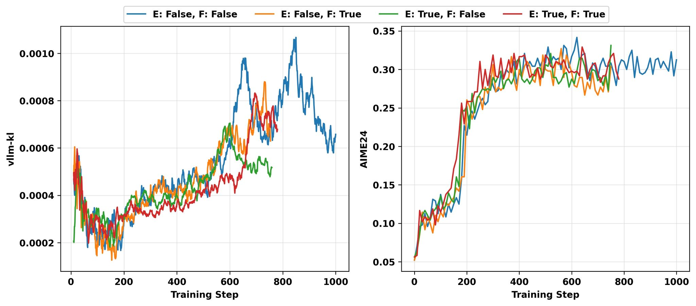
***Figure 13****: Ablation study on ****vLLM****-acceleration-and-cache-related hyperparameters  in reasoning RL. We conducted on-policy GRPO experiments on H100 GPUs with four possible combinations of the hyperparameters **`enforce_eager`** (****E****) and **`free_cache_engine`** (****F****). ****Left****: The dynamics of **`vllm-kl`** metric. ****Right****: the dynamics of the accuracy on AIME24.*

<!-- block:277211a5-58b7-8090-b5aa-dfaba7160a2c type:divider depth:1 -->
---

<!-- block:271211a5-58b7-801e-bd8e-d67fd96e9ee5 type:sub_header depth:1 -->
### **4.2 Effective Attempts**

<!-- block:27b211a5-58b7-8099-ba48-fa8849ab54c8 type:sub_sub_header depth:1 -->
#### 4.2.1 A Principled Solution: Distribution Correction

<!-- block:27b211a5-58b7-8028-a894-f39591942a0a type:text depth:1 -->
The training-inference mismatch turns our otherwise on-policy RL problem into an off-policy one, where the policy used for generating rollouts (the *behavior policy*, $\textcolor{red}{\pi_{\theta}^{\mathrm{vllm}}}$) differs from the policy being trained (the *target policy*, $\textcolor{blue}{\pi_{\theta}^{\mathrm{fsdp}}}$). One theoretically sound way to correct for this distributional shift is **Importance Sampling (IS)**. However, the specific formulation of IS is critical for maintaining an unbiased gradient and achieving stable training.

<!-- block:27b211a5-58b7-80ea-9015-dfe301d70459 type:text depth:1 -->
Inspired by the findings in [(Yao et al., 2025)](https://fengyao.notion.site/off-policy-rl), which first highlighted this implicit off-policy issue due to training-inference mismatch, we analyze two primary forms of IS: the theoretically sound **sequence-level IS** and the common but biased **token-level IS** approximation.

<!-- block:289211a5-58b7-8071-b0be-e76f08be4134 type:divider depth:1 -->
---

<!-- block:27b211a5-58b7-80b3-8c1a-f3aee1f533e7 type:sub_sub_header depth:1 -->
#### The Principled Estimator: Sequence-Level IS

<!-- block:27b211a5-58b7-806e-ac43-e57c91c63c41 type:text depth:1 -->
The correct, unbiased policy gradient estimator applies a single importance ratio over the entire generated sequence (trajectory) $y$. This correctly re-weights the expectation from the behavior policy to the target policy, yielding the true gradient of the objective function $J(\theta)$.

<!-- block:27b211a5-58b7-8082-aa22-de1abe0b6193 type:text depth:1 -->
Let's derive the Sequence-Level IS estimator $g_{\mathrm{seq}}(\theta)$ step-by-step.

<!-- block:27b211a5-58b7-8046-af3c-d89a7eab1c3b type:numbered_list depth:1 -->
1. The objective is to maximize the expected reward under the target **FSDP policy**:

<!-- block:27b211a5-58b7-80d8-939a-e993347e1e33 type:equation depth:2 -->
$$
J(\theta) = \mathbb{E}_{x \sim \mathcal{D}, y \sim \textcolor{blue}{\pi_{\theta}^{\mathrm{fsdp}}}(\cdot|x)}[R(x,y)]
$$

<!-- block:27b211a5-58b7-80d1-b104-c1de2852404a type:numbered_list depth:1 -->
1. The true policy gradient is therefore:

<!-- block:27b211a5-58b7-80dc-8ccc-e9b652de2714 type:equation depth:2 -->
$$
g(\theta) = \nabla_{\theta} J(\theta) = \mathbb{E}_{x \sim \mathcal{D}, y \sim \textcolor{blue}{\pi_{\theta}^{\mathrm{fsdp}}}(\cdot|x)}\left[R(x,y) \nabla_{\theta} \log \textcolor{blue}{\pi_{\theta}^{\mathrm{fsdp}}}(y|x)\right]
$$

<!-- block:27b211a5-58b7-805f-91d8-e23264b3b3e9 type:numbered_list depth:1 -->
1. Since we can only sample from the **vLLM policy**, we use importance sampling to change the distribution of the expectation:

<!-- block:27b211a5-58b7-8067-a347-c5e8224e4b20 type:equation depth:2 -->
$$
g_{\mathrm{seq}}(\theta) = \mathbb{E}_{x \sim \mathcal{D}, y \sim \textcolor{red}{\pi_{\theta}^{\mathrm{vllm}}}(\cdot|x)}\left[ \frac{\textcolor{blue}{\pi_{\theta}^{\mathrm{fsdp}}}(y|x)}{\textcolor{red}{\pi_{\theta}^{\mathrm{vllm}}}(y|x)} \cdot R(x,y) \cdot \nabla_{\theta} \log \textcolor{blue}{\pi_{\theta}^{\mathrm{fsdp}}}(y|x) \right]
$$

<!-- block:289211a5-58b7-8009-91d5-e73cbd4f8d0c type:text depth:1 -->
This is essentially off-policy **REINFORCE algorithm (****[Williams, 1992](https://doi.org/10.1007/BF00992696)****)** . This estimator is mathematically equivalent to the standard advantage form of the policy gradient. The key is to show that the importance sampling ratio precisely corrects the expectation, revealing the true on-policy gradient underneath, which can then be refined.

<!-- block:289211a5-58b7-80f2-8cad-efc62fc53011 type:toggle depth:1 -->
Click to see the detailed derivation

<!-- block:289211a5-58b7-80f7-8aed-cdffcac5b087 type:sub_sub_header depth:2 -->
#### Step 1: Convert the Expectation to its On-Policy Form

<!-- block:289211a5-58b7-8091-9feb-d9240d8bc783 type:text depth:2 -->
The IS estimator takes its expectation with respect to the behavior policy $\textcolor{red}{\pi^{\mathrm{vllm}}}$. By writing out the definition of expectation as an integral, the behavior policy density $\textcolor{red}{p_{\theta}^{\mathrm{vllm}}}(y|x)$ cancels out:

<!-- block:289211a5-58b7-8024-ad84-e96456fbba81 type:equation depth:2 -->
$$
g_{\mathrm{seq}}(\theta) = \int \left( \frac{\pi_{\textcolor{blue}{\theta}}^{\mathrm{fsdp}}(y|x)}{\pi_{\textcolor{red}{\theta}}^{\mathrm{vllm}}(y|x)} \cdot R(x,y) \cdot \nabla_{\theta} \log \pi_{\textcolor{blue}{\theta}}^{\mathrm{fsdp}}(y|x) \right) \pi_{\textcolor{red}{\theta}}^{\mathrm{vllm}}(y|x) \,dy
= \int \left( R(x,y) \cdot \nabla_{\theta} \log \pi_{\textcolor{blue}{\theta}}^{\mathrm{fsdp}}(y|x) \right) \pi_{\textcolor{blue}{\theta}}^{\mathrm{fsdp}}(y|x) \,dy
$$

<!-- block:289211a5-58b7-809f-a5cb-d1344b242f26 type:divider depth:2 -->
---

<!-- block:289211a5-58b7-808a-a07b-d1824f44cd90 type:text depth:2 -->
This leaves us with the true on-policy gradient, where the expectation is now over the target policy $\textcolor{blue}{\pi_{\theta}^{\mathrm{fsdp}}}$. This proves that $g_{\mathrm{seq}}(\theta)$ is an unbiased estimator of the true policy gradient.

<!-- block:289211a5-58b7-80a7-b47e-e39882ddae36 type:equation depth:2 -->
$$
g(\theta) = \mathbb{E}_{y \sim \textcolor{blue}{\pi_{\theta}^{\mathrm{fsdp}}}} \left[ R(x,y) \cdot \nabla_{\theta} \log \pi_{\textcolor{blue}{\theta}}^{\mathrm{fsdp}}(y|x) \right]
$$

<!-- block:289211a5-58b7-806e-b680-dfa3d1f98fe9 type:sub_sub_header depth:2 -->
#### Step 2: Decompose into Timesteps and Apply Causality

<!-- block:289211a5-58b7-8006-a9ea-e1305b781ddc type:text depth:2 -->
Now working with the simpler on-policy expression, we expand the trajectory-level terms and apply the principle of **causality** (an action at step $t$ only affects future rewards). This allows us to replace the total reward $R(x,y)$ with the **return-to-go** $G_t = \sum_{k=t}^{|y|-1} r(s_k, a_k)$.

<!-- block:289211a5-58b7-8017-b641-f147bb98a16c type:equation depth:2 -->
$$
g(\theta) = \mathbb{E}_{y \sim \textcolor{blue}{\pi_{\theta}}} \left[ \sum_{t=0}^{|y|-1} G_t \cdot \nabla_{\theta} \log \textcolor{blue}{\pi_{\theta}}(a_t|s_t) \right]
$$

<!-- block:289211a5-58b7-807d-936b-d5b02abe23ff type:divider depth:2 -->
---

<!-- block:289211a5-58b7-8086-ad70-da0fb252b068 type:sub_sub_header depth:2 -->
#### Step 3: Introduce the Advantage Function

<!-- block:289211a5-58b7-8004-b085-f353e303dfc3 type:text depth:2 -->
For variance reduction, we subtract a state-dependent **baseline,** the value function $V^{\textcolor{blue}{\pi_{\theta}}}(s_t)$. This converts the return-to-go into the **Advantage Function**, $A^{\textcolor{blue}{\pi_{\theta}}}(s_t, a_t) = G_t - V^{\textcolor{blue}{\pi_{\theta}}}(s_t)$.

<!-- block:289211a5-58b7-80e2-ad00-fe5c60549689 type:equation depth:2 -->
$$
g(\theta) = \mathbb{E}_{y \sim \textcolor{blue}{\pi_{\theta}}} \left[ \sum_{t=0}^{|y|-1} A^{\textcolor{blue}{\pi_{\theta}}}(s_t, a_t) \cdot \nabla_{\theta} \log \textcolor{blue}{\pi_{\theta}}(a_t|s_t) \right]
$$

<!-- block:289211a5-58b7-80c4-8184-f234adb21fe2 type:divider depth:2 -->
---

<!-- block:289211a5-58b7-8039-aa9c-faafbb089f1e type:sub_sub_header depth:2 -->
#### Step 4: Convert to State-Level Expectation

<!-- block:289211a5-58b7-805f-8306-fbcf3f39a585 type:text depth:2 -->
The final step rewrites the expectation over trajectories into an equivalent expectation over the state-visitation distribution $d_{\textcolor{blue}{\pi_{\theta}}}$ induced by the target policy.

<!-- block:289211a5-58b7-801b-8cb8-c5121dea3004 type:toggle depth:2 -->
Click for the detailed math from Step 3 to Step 4

<!-- block:289211a5-58b7-8091-8e88-d1459cd4b521 type:sub_sub_header depth:3 -->
#### **Step A: Start with the Trajectory-Level Expectation**

<!-- block:289211a5-58b7-80f3-b219-ef5813cd4226 type:equation depth:3 -->
$$
g(\theta) = \mathbb{E}_{y \sim \textcolor{blue}{\pi_{\theta}}} \left[ \sum_{t=0}^{|y|-1} A^{\textcolor{blue}{\pi_{\theta}}}(s_t, a_t) \cdot \nabla_{\theta} \log \textcolor{blue}{\pi_{\theta}}(a_t|s_t) \right]
$$

<!-- block:289211a5-58b7-80dd-9b6a-e71ce6012607 type:sub_sub_header depth:3 -->
#### **Step B: Apply Linearity of Expectation**

<!-- block:289211a5-58b7-8076-af07-c38a885217b1 type:text depth:3 -->
Swap the expectation and summation operators. We can extend the sum to infinity because any terms for timesteps $t$ beyond a trajectory's finite length $|y|$ are zero, so we are just adding zeros.

<!-- block:289211a5-58b7-80e4-8ae8-cdc592bf318b type:equation depth:3 -->
$$
g(\theta) = \sum_{t=0}^{\infty} \mathbb{E}_{y \sim \textcolor{blue}{\pi_{\theta}}} \left[ A^{\textcolor{blue}{\pi_{\theta}}}(s_t, a_t) \cdot \nabla_{\theta} \log \textcolor{blue}{\pi_{\theta}}(a_t|s_t) \right]
$$

<!-- block:289211a5-58b7-8070-ba4c-ea6524d1ccaa type:sub_sub_header depth:3 -->
#### **Step C: Expand the Expectation into an Explicit Sum**

<!-- block:289211a5-58b7-8021-a3a8-c6030a5f4ac6 type:text depth:3 -->
Rewrite the inner expectation by summing over every possible state $s$ and action $a$, weighted by their joint probability $P(s_t=s, a_t=a) = P(s_t=s) \cdot \textcolor{blue}{\pi_{\theta}}(a|s)$.

<!-- block:289211a5-58b7-8087-9363-d6ae518b6599 type:equation depth:3 -->
$$
g(\theta) = \sum_{t=0}^{\infty} \sum_{s \in \mathcal{S}} P(s_t=s | \textcolor{blue}{\pi_{\theta}}) \sum_{a \in \mathcal{A}} \textcolor{blue}{\pi_{\theta}}(a|s) \cdot \left[ A^{\textcolor{blue}{\pi_{\theta}}}(s, a) \cdot \nabla_{\theta} \log \textcolor{blue}{\pi_{\theta}}(a|s) \right]
$$

<!-- block:289211a5-58b7-80d3-89b0-e29d8e957a4f type:sub_sub_header depth:3 -->
#### **Step D: Introduce the State Occupancy Measure**

<!-- block:289211a5-58b7-80bf-8967-f3ac6f31819b type:text depth:3 -->
Rearrange the summations to group all terms related to state $s$.

<!-- block:289211a5-58b7-8025-8d2b-fa528388c13c type:equation depth:3 -->
$$
g(\theta) = \sum_{s \in \mathcal{S}} \left( \sum_{t=0}^{\infty} P(s_t=s | \textcolor{blue}{\pi_{\theta}}) \right) \left( \sum_{a \in \mathcal{A}} \textcolor{blue}{\pi_{\theta}}(a|s) \cdot \left[ \dots \right] \right)
$$

<!-- block:289211a5-58b7-80fc-af18-e31010bab8fa type:text depth:3 -->
The first term, $\sum_{t=0}^{\infty} P(s_t=s)$, is the definition of the **state occupancy measure**, $d_{\textcolor{blue}{\pi_{\theta}}}(s)$. The second term is the definition of an expectation over actions, $\mathbb{E}_{a \sim \textcolor{blue}{\pi_{\theta}}(\cdot|s)}[\dots]$.

<!-- block:289211a5-58b7-809e-84e4-f908f366ea96 type:equation depth:3 -->
$$
g(\theta) = \sum_{s \in \mathcal{S}} d_{\textcolor{blue}{\pi_{\theta}}}(s) \cdot \mathbb{E}_{a \sim \textcolor{blue}{\pi_{\theta}}(\cdot|s)} \left[ A^{\textcolor{blue}{\pi_{\theta}}}(s, a) \cdot \nabla_{\theta} \log \textcolor{blue}{\pi_{\theta}}(a|s) \right]
$$

<!-- block:289211a5-58b7-80f8-bec6-ccdcdd2dd674 type:sub_sub_header depth:3 -->
#### **Step E: Arrive at the Final Form**

<!-- block:289211a5-58b7-80ea-9606-c93b801e00ea type:text depth:3 -->
The sum over all states weighted by the state occupancy measure is, by definition, an expectation over the state distribution $d_{\textcolor{blue}{\pi_{\theta}}}$.

<!-- block:289211a5-58b7-8075-a61a-ee89489e5bca type:equation depth:3 -->
$$
g(\theta) = \mathbb{E}_{s \sim d_{\textcolor{blue}{\pi_{\theta}}}} \left[ \mathbb{E}_{a \sim \textcolor{blue}{\pi_{\theta}}(\cdot|s)} \left[ A^{\textcolor{blue}{\pi_{\theta}}}(s,a) \cdot \nabla_{\theta} \log \textcolor{blue}{\pi_{\theta}}(a|s) \right] \right]
$$

<!-- block:289211a5-58b7-808a-b58a-eca7e54243df type:text depth:3 -->


<!-- block:289211a5-58b7-8060-a9be-da7f35d08b75 type:text depth:1 -->
This derivation leads us to the final advantage form of the policy gradient:

<!-- block:289211a5-58b7-80b4-bcdb-da10cf597072 type:equation depth:1 -->
$$
g_{\mathrm{seq}}(\theta) = \mathbb{E}_{s \sim d_{\textcolor{blue}{\pi_{\theta}^{\mathrm{fsdp}}}}} \mathbb{E}_{a \sim \textcolor{blue}{\pi_{\theta}^{\mathrm{fsdp}}}(\cdot|s)} \left[ A^{\textcolor{blue}{\pi_{\theta}^{\mathrm{fsdp}}}}(s,a) \cdot \nabla_{\theta} \log \textcolor{blue}{\pi_{\theta}^{\mathrm{fsdp}}}(a|s) \right]
$$

<!-- block:27b211a5-58b7-8039-a35a-d71630e066ff type:text depth:1 -->
Here, $s=(x,y_{<t})$** is the state (prefix), **$a=y_t$** is the action (token). ****The term** $d_{\textcolor{blue}{\pi_{\theta}^{\mathrm{fsdp}}}}$ **is the state occupancy measure** under the target FSDP policy. It is formally defined as the expected number of times a state $s$ is visited when following policy $\pi$:

<!-- block:27b211a5-58b7-80bf-99b1-cdf1930a09eb type:equation depth:1 -->
$$
\textcolor{blue}{d_{\pi}(s) := \mathbb{E}_{x' \sim \mathcal{D}, y' \sim \pi(\cdot|x')} \left[ \sum_{t'=0}^{|y'|-1} \mathbb{I}\{ (x', y'_{<t'}) = s \} \right] = P(x) \cdot \prod_{k=0}^{t-1} \pi(y_k|x,y_{<k})}
$$

<!-- block:27b211a5-58b7-8086-a833-dbc5963166e0 type:text depth:1 -->
This estimator is **unbiased**, meaning $g_{\mathrm{seq}}(\theta) = g(\theta)$. For numerical stability, **Truncated Importance Sampling (TIS)** is used, which clips the sequence-level ratio $\rho(y|x)$ at a constant $C$.

<!-- block:27b211a5-58b7-80ea-a3f0-f3ea70b3986a type:divider depth:1 -->
---

<!-- block:27b211a5-58b7-80a6-9cb7-c2c0f2290efa type:sub_sub_header depth:1 -->
#### A Common Biased Estimator: Token-Level IS

<!-- block:27b211a5-58b7-804d-b908-ec1b23283224 type:text depth:1 -->
A common heuristic, often inspired by algorithms like PPO and used in [(Yao et al., 2025)](https://fengyao.notion.site/off-policy-rl), applies a per-token importance ratio. While this typically has lower variance than the sequence-level ratio, it is a **biased estimator** that is theoretically unsound for autoregressive models.

<!-- block:27b211a5-58b7-80cd-8895-d6444106476d type:text depth:1 -->
Let's derive the Token-Level IS gradient estimator, $g_{\mathrm{tok}}(\theta)$.

<!-- block:27b211a5-58b7-80b8-80c4-cd9678148d55 type:numbered_list depth:1 -->
1. The formulation begins by incorrectly applying the importance sampling ratio inside the sum over timesteps: i.e., $g_{\mathrm{tok}}(\theta)$ is defined as

<!-- block:27b211a5-58b7-80c8-913e-cbaecbb9ea8e type:equation depth:2 -->
$$
\mathbb{E}_{x \sim \mathcal{D}, y \sim \textcolor{red}{\pi_{\theta}^{\mathrm{vllm}}}(\cdot|x)}\left[ R(x,y) \cdot \sum_{t=0}^{|y|-1} \frac{\textcolor{blue}{\pi_{\theta}^{\mathrm{fsdp}}}(y_t|x,y_{<t})}{\textcolor{red}{\pi_{\theta}^{\mathrm{vllm}}}(y_t|x,y_{<t})} \cdot \nabla_{\theta} \log \textcolor{blue}{\pi_{\theta}^{\mathrm{fsdp}}}(y_t|x,y_{<t}) \right]
$$

<!-- block:27b211a5-58b7-8092-a371-e66d97325fb6 type:numbered_list depth:1 -->
1. We can rewrite this expectation over trajectories as an expectation over the states visited under the **vLLM policy**:

<!-- block:27b211a5-58b7-80c6-aed3-d2e7a39e4c99 type:equation depth:2 -->
$$
g_{\mathrm{tok}}(\theta) = \mathbb{E}_{s \sim d_{\textcolor{red}{\pi_{\theta}^{\mathrm{vllm}}}}} \mathbb{E}_{a \sim \textcolor{red}{\pi_{\theta}^{\mathrm{vllm}}}(\cdot|s)} \left[ \frac{\textcolor{blue}{\pi_{\theta}^{\mathrm{fsdp}}}(a|s)}{\textcolor{red}{\pi_{\theta}^{\mathrm{vllm}}}(a|s)} \cdot A^{\textcolor{red}{\pi_{\theta}^{\mathrm{vllm}}}}(s,a) \cdot \nabla_{\theta} \log \textcolor{blue}{\pi_{\theta}^{\mathrm{fsdp}}}(a|s) \right]
$$

<!-- block:27b211a5-58b7-80b5-bbcd-eb308ea91cba type:numbered_list depth:1 -->
1. *Note: Here, *$R(x,y)$* is the empirical return from the full trajectory sampled by *$\textcolor{red}{\pi_{\theta}^{\mathrm{vllm}}}$*, which serves as a Monte Carlo estimate for the state-action value *$Q^{\textcolor{red}{\pi_{\theta}^{\mathrm{vllm}}}}(s,a)$*. I*ntroducing a baseline and changing the expectation over actions gives the final form:

<!-- block:27b211a5-58b7-804e-b8cf-e67c868eb617 type:equation depth:2 -->
$$
g_{\mathrm{tok}}(\theta) = \mathbb{E}_{s \sim d_{\textcolor{red}{\pi_{\theta}^{\mathrm{vllm}}}}} \mathbb{E}_{a \sim \textcolor{blue}{\pi_{\theta}^{\mathrm{fsdp}}}(\cdot|s)} \left[ A^{\textcolor{red}{\pi_{\theta}^{\mathrm{vllm}}}}(s,a) \cdot \nabla_{\theta} \log \textcolor{blue}{\pi_{\theta}^{\mathrm{fsdp}}}(a|s) \right]
$$

<!-- block:2bd211a5-58b7-8072-a024-ffc02a8003bb type:text depth:1 -->
This final expression clearly reveals the gradient bias of token-level IS.  It can be observed clearly that $J(\theta)$ can be optimized by $g_\text{tok}(\theta)$ **only when**  $\textcolor{red}{\pi_{\theta}^{\mathrm{vllm}}}$ stays in the trust region of $\textcolor{blue}{\pi_{\theta}^{\mathrm{fsdp}}}$, where $d_{\textcolor{red}{\pi_{\theta}^{\mathrm{vllm}}}}\approx d_{\textcolor{blue}{\pi_{\theta}^{\mathrm{fsdp}}}}$ and $A^{\textcolor{red}{\pi_{\theta}^{\mathrm{vllm}}}}\approx A^{\textcolor{blue}{\pi_{\theta}^{\mathrm{fsdp}}}}$. 

<!-- block:2bd211a5-58b7-8050-9776-f66576f19645 type:text depth:1 -->


<!-- block:27b211a5-58b7-80e8-8fa5-f1881eebd895 type:divider depth:1 -->
---

<!-- block:27b211a5-58b7-807b-88a0-ed3abb1a0eea type:sub_sub_header depth:1 -->
#### The Source of Bias in Token-Level IS

<!-- block:27b211a5-58b7-8033-9d71-f60621840386 type:text depth:1 -->
Comparing $g_{\mathrm{tok}}(\theta)$ with the true gradient $g_{\mathrm{seq}}(\theta)$ reveals two distinct and significant errors that render the token-level estimator biased.

<!-- block:27b211a5-58b7-80fd-a20c-f07a56e3a9a9 type:sub_sub_header depth:1 -->
#### **Source 1: State Occupancy Mismatch 🗺️**

<!-- block:27b211a5-58b7-806a-9a0f-ed068ec37364 type:text depth:1 -->
A sound off-policy correction must account for two distributional shifts: the action probabilities and the state visitation probabilities. The token-level method only corrects for the first.

<!-- block:27b211a5-58b7-806a-839d-d5acc2f507c9 type:bulleted_list depth:1 -->
- **True Gradient (**$g_{\mathrm{seq}}$**):** The expectation is over states visited under **the correct target fsdp distribution**, $\mathbb{E}_{s \sim d_{\textcolor{blue}{\pi_{\theta}^{\mathrm{fsdp}}}}}$.

<!-- block:27b211a5-58b7-8059-bc47-d7971240e2a0 type:bulleted_list depth:1 -->
- **Flawed Gradient (**$g_{\mathrm{tok}}$**):** The expectation is over states visited under the **incorrect behavior vLLM distribution**, $\mathbb{E}_{s \sim d_{\textcolor{red}{\pi_{\theta}^{\mathrm{vllm}}}}}$.

<!-- block:27b211a5-58b7-809f-8db5-d3c658a36d34 type:text depth:1 -->
This implicitly assumes the state occupancy ratio is 1, i.e. ${d_{\textcolor{blue}{\pi^{\mathrm{fsdp}}}}(s)} /{d_{\textcolor{red}{\pi^{\mathrm{vllm}}}}(s)} = 1$. This assumption is catastrophically violated in autoregressive models; due to deterministic transitions, a single different token choice guarantees that state trajectories diverge completely. By ignoring this, $g_{\mathrm{tok}}(\theta)$ introduces a large, uncontrolled bias.

<!-- block:27b211a5-58b7-802b-83de-e69ca2d3187e type:sub_sub_header depth:1 -->
#### **Source 2: Mismatched Reward Signal 🎯**

<!-- block:27b211a5-58b7-8041-9fcd-da1271e86d50 type:text depth:1 -->
The second critical error is that the token-level gradient weights the update with a reward signal from the **wrong policy**.

<!-- block:27b211a5-58b7-80f4-9abe-d8309854198b type:bulleted_list depth:1 -->
- **True Gradient (**$g_{\mathrm{seq}}$**):** The update is scaled by the advantage function of the **target fsdp policy**, $A^{\textcolor{blue}{\pi_{\theta}^{\mathrm{fsdp}}}}$, representing the expected future reward under that policy.

<!-- block:27b211a5-58b7-8034-89d9-d463f69f8565 type:bulleted_list depth:1 -->
- **Flawed Gradient (**$g_{\mathrm{tok}}$**):** The update is scaled by the advantage function of the **behavior vLLM policy**, $A^{\textcolor{red}{\pi_{\theta}^{\mathrm{vllm}}}}$.

<!-- block:27b211a5-58b7-8019-bbfe-e109de1671a2 type:text depth:1 -->
The gradient for the target policy is being scaled by a reward signal that belongs to the behavior policy. Because both the state distribution and the reward signal are fundamentally mismatched, the token-level gradient is a biased and theoretically unsound estimator. 

<!-- block:27b211a5-58b7-8047-8961-ca6df2c07d96 type:callout depth:1 -->


<!-- block:27b211a5-58b7-8078-911a-f1aea4303053 type:text depth:2 -->
These theories suggest that despite the potential for lower variance in token-level methods, gradient bias nonetheless persists, potentially leading to training instability— **a prediction our experiments go on to confirm.  **We also present the detailed bias and variance analysis (**[part 1](https://richardli.xyz/rl-collapse-1)** & **[part2](https://richardli.xyz/rl-collapse-2)**) on both token-level and sequence-level methods.

<!-- block:27b211a5-58b7-80f0-9e0e-c6e4cf2f846f type:divider depth:1 -->
---

<!-- block:27b211a5-58b7-8081-8192-d3f2dc686da4 type:sub_sub_header depth:1 -->
#### Experimental Validation

<!-- block:27b211a5-58b7-80b4-aa84-c1f173bd3842 type:text depth:1 -->
Our theoretical analysis predicts that the biased token-level IS will be unstable and ultimately fail, while the unbiased sequence-level IS will be robust. Our experiments confirm this.

<!-- block:27b211a5-58b7-80cc-860e-d7fb96fdf309 type:sub_sub_header depth:1 -->
#### **IS Prevents Gradient Explosion, but Token-Level Still Fails**

<!-- block:27b211a5-58b7-8019-8075-f3f7b3a8354d type:text depth:1 -->
We resumed a crashed experiment on an L20 GPU with both token-level TIS and sequence-level TIS ($C=2$), starting from its 200th training step. As shown in Figure 14, while both initially prevent the gradient explosion seen in the vanilla experiment, the run with **token-level TIS still collapses later**. The run with sequence-level TIS remains stable, validating our theory that the biased gradients from the token-level method eventually lead to failure.

<!-- block:271211a5-58b7-8008-aab6-ca175a776bdd type:image depth:1 -->
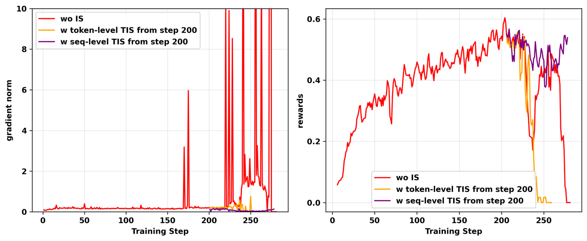
***Figure 14: ****Ablation study on the use of different TIS strategy.  The ****vanilla on-policy**** **experiment without IS crashes after 200 steps and experiences a gradient explosion. We resume the RL training with additional ****token-level TIS**** and ****sequence-level TIS****  strategy from the 200th training step, respectively.  ****Left****:  the dynamics of gradient norm during RL training. ****Right****: the dynamics of  training rewards during RL training.*

<!-- block:27b211a5-58b7-8016-9cb8-ff6f0de98a30 type:sub_sub_header depth:1 -->
#### **Token-Level TIS in Reasoning RL**

<!-- block:27b211a5-58b7-8039-9112-d72fa45bb16d type:text depth:1 -->
Although token-level TIS fails in our complex TIR experiments, it can help prevent collapse in simpler reasoning RL, where the mismatch is smaller. In on-policy GRPO and RLOO experiments (Figure 15), token-level TIS prevented gradient explosion, but training remained unstable and did not achieve better final performance, likely due to the underlying gradient bias.

<!-- block:271211a5-58b7-80a6-89b2-f5313ed260bf type:image depth:1 -->
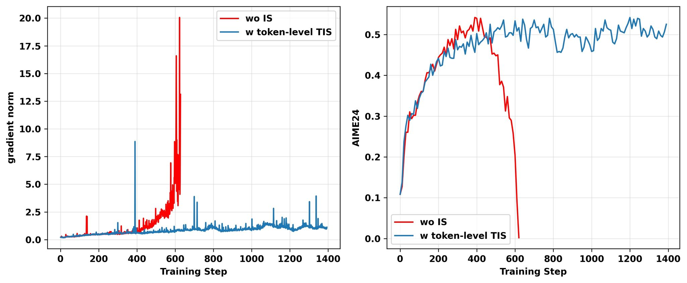
***Figure 15 (a):**** Gradient norm (****Left****) and accuracy on AIME 24 (****Right****) of on-policy GRPO experiments on H100 GPUs **without IS **and with** token-level IS (C=2) **in reasoning RL. Token-level TIS prevents training collapse but does not achieve better test performance.*

<!-- block:27b211a5-58b7-80b6-8007-d80f67c22b85 type:image depth:1 -->
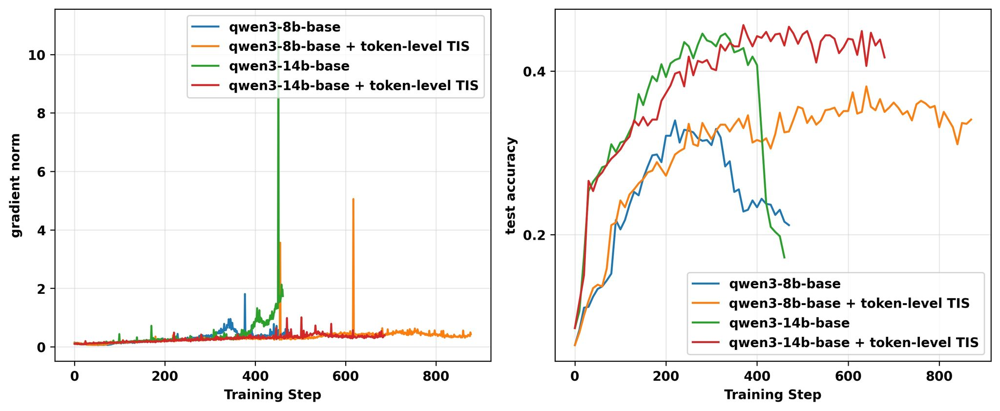
***Figure 15 (b):**** Gradient norm (****Left****) and average accuracy on AIME 24 / AIME25 (****Right****) of on-policy RLOO experiments on H100 GPUs **without IS and with token-level IS (C=2)** **in reasoning RL. Token-level TIS mitigates training collapse but does not achieve better test performance. In the later stage, TIS has a tendency of performance dropping.*

<!-- block:27b211a5-58b7-809c-95f3-c38299424cb3 type:sub_sub_header depth:1 -->
#### **TIS Prolongs Training But Can Suffer from Instability**

<!-- block:27b211a5-58b7-8074-8280-d60a1f521829 type:text depth:1 -->
We conducted an on-policy TIR experiment from scratch on L20 GPUs with sequence-level TIS ($C=2$). As shown in Figure 16, while the method prevented a complete collapse, the reward curve exhibited continuous fluctuations after reaching a plateau, and its test performance did not exceed the peak achieved by the vanilla experiment before it crashed.

<!-- block:27b211a5-58b7-80aa-abaf-e901a524bca8 type:image depth:1 -->
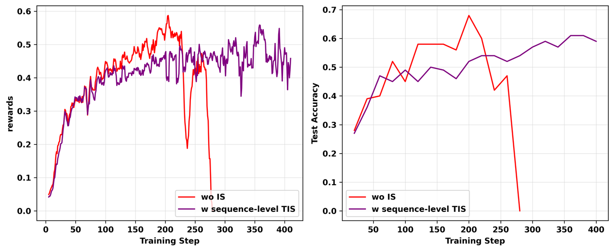
***Figure 16: ****Ablation study on the use of different TIS strategy (Cont’d).  The ****vanilla on-policy**** **experiment without IS crashes after 200 steps. We reran the failed experiment from scratch using the same configuration, with the addition of  ****sequence-level TIS**** of  **$C=2$**.  ****Left****:  the dynamics of training rewards during RL training. ****Right****: the dynamics of  test accuracy during RL training.*

<!-- block:27b211a5-58b7-8018-a714-c70402ddf952 type:sub_sub_header depth:1 -->
#### **Masked Importance Sampling (MIS)**

<!-- block:27b211a5-58b7-80d0-a036-ddcfbe517351 type:text depth:1 -->
To improve upon TIS, we propose **Masked Importance Sampling (MIS)**, which masks the policy loss for sequences where the IS ratio exceeds the threshold $C$ (i.e., $\rho(y|x) \gets \rho(y|x) \mathbb{I}\{\rho(y|x) \le C\}$). As shown in Figure 17, MIS not only stabilized training but also surpassed the peak training rewards and test accuracy of both the vanilla and TIS experiments.

<!-- block:27b211a5-58b7-808b-92f0-f53e0439f9d6 type:image depth:1 -->
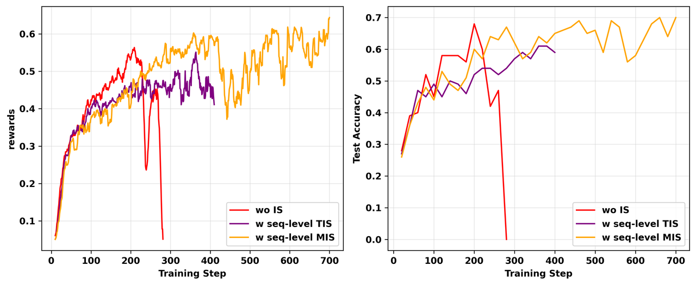
***Figure 17: **** Comparison of on-policy GRPO with sequence level **MIS**, **TIS**, and the **vanilla version without IS.  **All three  experiments were conducted on L20 GPUs. Compared to the** vanilla on-policy** experiment, the introduction of both **MIS **and **TIS **extended the training duration, but both also suffered from training instability in the later stages. Compared to **TIS**, **MIS **shows  improvements in both training reward and test set accuracy, also surpassing the peak performance of the vanilla experiment without IS. ****Left****:  the dynamics of training rewards during RL training. ****Right****: the dynamics of  test accuracy during RL training.*

<!-- block:27b211a5-58b7-8051-a317-d40175e29b7a type:sub_sub_header depth:1 -->
#### **Token-Level MIS vs. Sequence-Level MIS**

<!-- block:27b211a5-58b7-80c5-aac5-c904c8662cee type:text depth:1 -->
Finally, we compared token-level MIS against sequence-level MIS. As expected, Figure 18 shows that while both prevent the initial gradient explosion, the **token-level MIS experiment still collapses**. This reinforces our conclusion that for complex, long-horizon autoregressive tasks, only a theoretically sound, sequence-level correction is reliable.

<!-- block:27b211a5-58b7-80a9-9837-dc6b5f980e1b type:image depth:1 -->
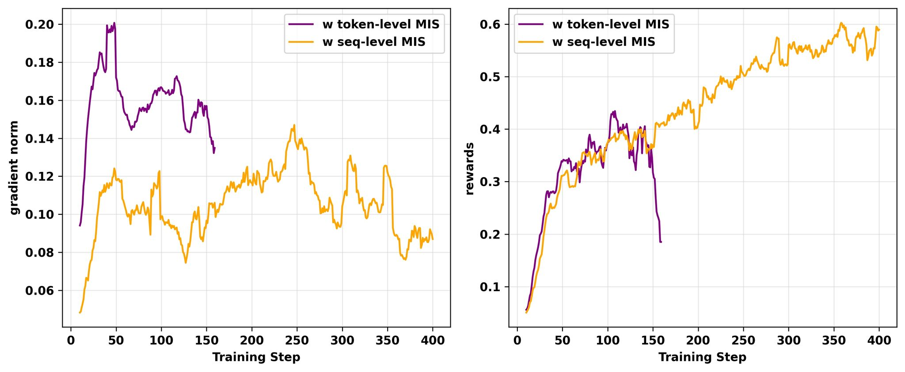
***Figure 18: **** Comparison of on-policy GRPO with **token-level MIS** **and **sequence-level MIS**.  **Both experiments were conducted on L20 GPUs and same configuration. ****Left****:  the dynamics of gradient norm during RL training. ****Right****: the dynamics of  training rewards during RL training.*

<!-- block:271211a5-58b7-80f8-a38a-dae34f381bef type:sub_sub_header depth:1 -->
#### 4.2.2 Top-p Sampling

<!-- block:271211a5-58b7-809c-9cf7-ce530f69f705 type:text depth:1 -->
As we discussed above, we observe that low probability tokens of **vLLM **policy  are more prone to severe training-inference mismatch issues, leading to extremely low probabilities** **of **FSDP **policy. To further corroborate this, we conducted the following top-p ablation study. We ran on-policy GRPO experiments on L20 GPUs and set the `top-p` hyperparameters for vLLM sampling policy to 0.98, 0.99, and 0.999 respectively (note that we did not apply importance sampling for gradient correction). By setting a smaller `top-p` value, we aim to decrease the frequency of extremely low-vllm-probability tokens during the inference stage, thereby mitigating the training-inference mismatch. Our ablation results are shown in Figure 19. As expected, the `vllm-kl` metric indicates that a smaller `top-p` reduces the occurrence of `vllm-kl` spikes. However, it is important to note that a smaller `top-p` also increases the distribution divergence between the **vLLM **policy  $\textcolor{red}{\pi^{\text{vllm}}_\theta}$ and the **FSDP **policy   $\textcolor{blue}{\pi^{\text{fsdp}}_\theta}$. Consequently, without applying TIS, the gradient bias becomes larger, leading to slower reward improvement as `top-p` decreases.

<!-- block:271211a5-58b7-80a0-9f28-d37a3e81825e type:image depth:1 -->
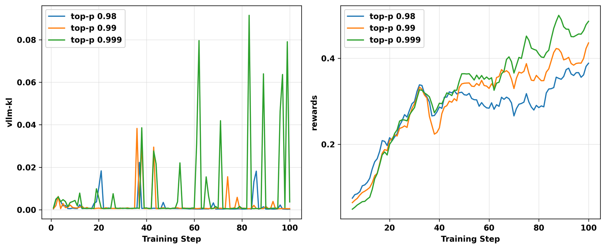
***Figure 19: ****Ablation study on the use of different **`top-p`** value in ****vLLM ****sampling policy during the RL training. We ran on-policy GRPO experiments  with **`top-p`** equals to 0.98, 0.99 and 0.999 respectively.  It can be observed that setting a smaller **`top-p`** value generally yields a smaller **`vllm-kl`** metric and slower reward improvement.  ****Left****:  the dynamics of **`vllm-kl`** metric during RL training. ****Right****: the dynamics of  training rewards during RL training. *

<!-- block:271211a5-58b7-8013-9729-e1f74e6c65ae type:sub_sub_header depth:1 -->
#### **4.2.3 Use other GPU series**

<!-- block:271211a5-58b7-8099-83b6-cfe6b0b5c1e7 type:text depth:1 -->
After discovering that the training–inference mismatch in experiments run on the H20 GPUs was significantly smaller than that on the L20 GPUs, we switched all our TIR experiments to the H20 GPUs, which greatly reduced the occurrence of training crashes. Figure 20 shows the results of the two on-policy GRPO experiments trained from scratch under identical configurations on the L20 and H20 GPUs, respectively. It can be observed that the on-policy experiment running on the H20 GPUs significantly extended the stable training duration and achieved better performance.

<!-- block:271211a5-58b7-8095-9c63-f3bcc7bbef56 type:image depth:1 -->
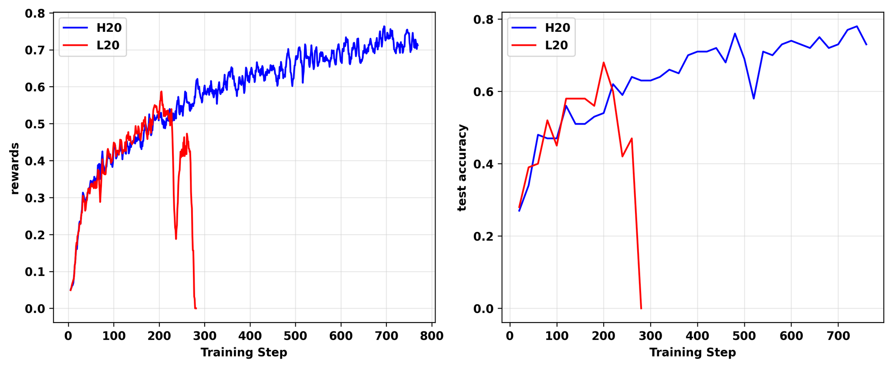
***Figure 20***: *Training rewards (****Left****) and test accuracy (****Right****) of two on-policy GRPO experiments conducted on L20 and H20 GPUs, respectively. *

<!-- block:27a211a5-58b7-80fa-b2d9-d85708b21084 type:sub_sub_header depth:1 -->
#### **4.2.4 Diable Cascade Attention in vLLM**

<!-- block:27a211a5-58b7-8064-b138-d3309bc466a0 type:text depth:1 -->
According to this [GitHub issue](https://github.com/vllm-project/flash-attention/pull/87), we set `disable_cascade_attn=True` when initializing the vLLM engine and found that it significantly helps reduce the training-inference mismatch in experiments conducted on A100 GPUs. We performed two on-policy GRPO experiments using Qwen3-14B-Base as the base model on A100 GPUs, with `disable_cascade_attn` set to `True` and `False`, respectively. The results are shown in Figure 21. It can be observed that after disabling cascade attention, the `vllm-kl` metric decreased from the range of 5e-2 to 1e-1 to around 1e-3, indicating a substantial reduction in training-inference mismatch. In addition, the rewards on the training set also increased appropriately.

<!-- block:27a211a5-58b7-8082-b200-d1681ccb6ceb type:image depth:1 -->
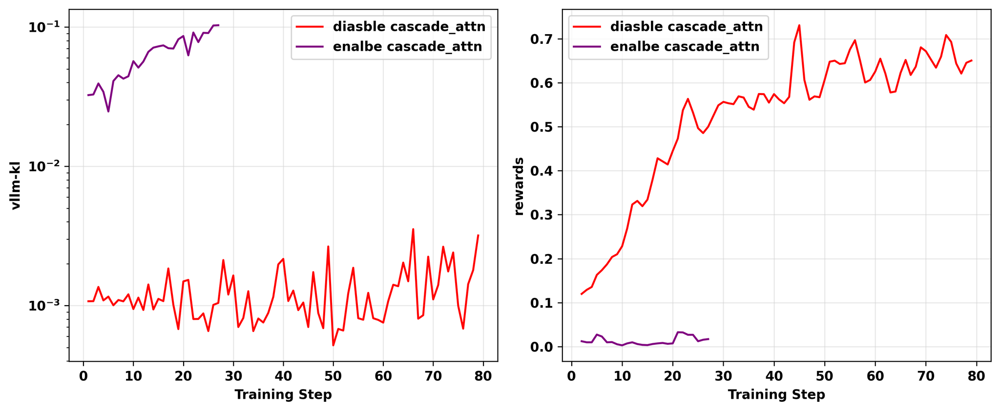
***Figure 21****: Results of the ablation study on using cascade attention. We conducted two on-policy experiments on A100 GPUs: one with **cascade attention enabled **and another with the same configuration but with **cascade attention disabled**.. ****Left****: The dynamics of **`vllm-kl`** metric. ****Right****: the dynamics of training rewards*

<!-- block:277211a5-58b7-806a-8461-c2c69bf1c100 type:divider depth:1 -->
---

<!-- block:271211a5-58b7-807d-aec4-ddd7af54a0b0 type:header depth:1 -->
## **5. Conclusion & Key Takeaways for Practitioners**

<!-- block:277211a5-58b7-8082-b87c-f9ff4d540628 type:text depth:1 -->
The training-inference mismatch is not a niche bug but a fundamental, growing challenge across modern **reasoning and agentic RL**, driven by the necessary pursuit of performance. Our investigation provides a clear roadmap for diagnosing and mitigating it. 📝

<!-- block:277211a5-58b7-801f-9a04-c7a042c03742 type:bulleted_list depth:1 -->
- **Mismatch is an Inevitable Trade-Off:** Accept that high-speed inference will always diverge from training calculations. This is a core trade-off, not a temporary flaw.

<!-- block:277211a5-58b7-80b9-b4fd-f9f021aa562d type:bulleted_list depth:1 -->
- **Monitor Your Health:** The `vllm-kl` metric is a vital early warning system. Track it alongside Perplexity (PPL) and gradient norms to predict and diagnose instability before it leads to collapse.

<!-- block:277211a5-58b7-804c-8ba9-f871c1bc24de type:bulleted_list depth:1 -->
- **Identify the Real Culprit:** The problem is not random. It is systematically triggered by **low-probability tokens**, which are generated more frequently when the model processes out-of-distribution (OOD) inputs—a common scenario in tool-use and multi-turn applications.

<!-- block:277211a5-58b7-805e-b7ee-f6c68cdddf4b type:bulleted_list depth:1 -->
- **Hardware is a First-Order Variable:** The same code can collapse on one GPU architecture and train perfectly on another. Always validate your setup on your target hardware, as results may not be exactly portable.

<!-- block:277211a5-58b7-8092-8fb5-d43746fdd375 type:bulleted_list depth:1 -->
- **Use Theoretically-Sound Corrections:** While changing hardware or tuning samplers can help, the most robust and principled solution is algorithmic. Our work demonstrates that theoretically biased, **token-level corrections are insufficient and can still fail in our experiments**. In contrast, **sequence-level methods like Truncated (Seq-TIS) and Masked (Seq-MIS) Importance Sampling** directly address the gradient bias by correcting for the full state trajectory. These methods are essential for maintaining stability and should be considered a default for any serious LLM-RL training stack.

<!-- block:277211a5-58b7-8013-b186-f5d0c4c4b315 type:text depth:1 -->
We hypothesize that this mismatch between inference engines (e.g., vLLM) and training frameworks (e.g., Megatron-LM) will also be a significant issue for **Mixture-of-Experts (MoE) RL**, which represents an interesting and critical direction for future investigation.

<!-- block:278211a5-58b7-807a-b606-fa0c8a6818f8 type:text depth:1 -->

